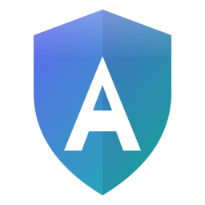
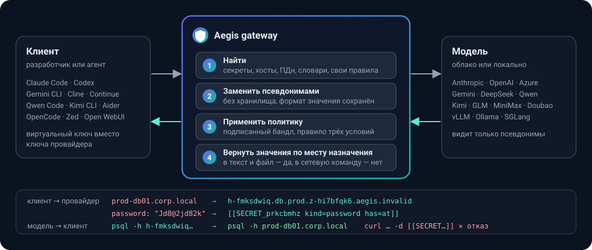

<p align="center">
  
</p>

<h1 align="center">Aegis</h1>

<p align="center">
  <b>A security control plane for LLMs and AI agents.</b><br>
  Your code and data reach the model as pseudonyms. Real values come back only where policy allows.
</p>

<p align="center">
  <a href="https://github.com/Paffin/Aegis/actions/workflows/ci.yml"></a>
  
  
  
  <a href="LICENSE"></a>
</p>

<p align="center"><a href="README.md">Русский</a> · most documentation is in Russian</p>

<p align="center">
  
</p>

## What it is

Aegis is a gateway that sits between developer tools or agents and LLM providers. The only change a client needs is the API base URL.

1. **Detects** secrets, infrastructure names, personal data, employee names and company terms.
2. **Replaces** them with pseudonyms that keep the shape of the value (a host stays a host, an IP stays an IP, subnets stay intact). There is no mapping store: a pseudonym is an HMAC of the value under the tenant key, so the gateway is stateless and scales horizontally.
3. **Restores** real values in the answer depending on the destination: into text and files, yes; into a network command, no. A tool call that would carry a secret out is replaced by an explanation the agent can read.
4. **Audits** without values, and applies a three-condition rule: private data plus untrusted content (a web page, `node_modules`) forbids network calls.

## Try it in two minutes

You need `cargo` and `python3`, no provider keys.

```bash
git clone https://github.com/Paffin/Aegis && cd Aegis
scripts/demo.sh                      # client -> Aegis -> a "provider" that prints what it received
cargo run -q -p aegis-cli -- scan path/to/repo --zone corp.local   # what would be masked in your files (no values printed)
```

## Supported

| Protocol | Endpoints | Clients |
|---|---|---|
| Anthropic Messages | `/v1/messages`, `count_tokens` | Claude Code, Cline, Roo, Kilo, Continue, Aider, Zed, OpenCode |
| OpenAI Responses (stateless) | `/v1/responses` | Codex CLI, OpenAI Agents SDK |
| OpenAI Chat Completions | `/v1/chat/completions` | Cline, Continue, Aider, Qwen Code, Kimi CLI, Goose, Open WebUI, any SDK |
| OpenAI Completions / Embeddings | `/v1/completions`, `/v1/embeddings` | autocomplete (FIM), code indexing |
| Google Gemini | `generateContent`, `streamGenerateContent`, `countTokens`, `embedContent` | Gemini CLI, Google GenAI SDKs |

Providers: Anthropic, OpenAI, Azure OpenAI, Google Gemini, DeepSeek, Qwen, Kimi, GLM, MiniMax, Doubao, Hunyuan, Qianfan, SiliconFlow, OpenRouter and others, plus local vLLM, SGLang, Ollama and llama.cpp without a key. See [docs/PROVIDERS.md](docs/PROVIDERS.md) and [docs/CLIENTS.md](docs/CLIENTS.md) (Russian).

Cursor, Windsurf and the built-in GitHub Copilot completions talk to the vendors' own servers and cannot be pointed at a gateway; only perimeter blocking applies ([`deploy/egress`](deploy/egress)).

## Status: alpha, read this

Measured with `aegis-bench`, repeated in CI: 2.76 false positives per 10k lines on 4.95M lines of open-source code (target: below 1; mostly real values such as package author e-mails); 100 % recall on 21 of 22 synthetic types and 98.9 % on assignment passwords (the corpus was written by the detectors' author, so the figure is optimistic); warm-turn latency p50 ≈ 5 ms / p95 ≈ 7 ms at ~219k tokens of context (cold first turn p95 ≈ 154 ms, target 400 ms); under load (30 req/s, ~860 KB history, 214 concurrent streams, one 4-core machine, generator and mock in the same process) the gateway adds p95 ≈ 10 ms to the time to first byte with no errors; 347 tests (including property tests, fuzzing and 1300+ exfiltration scenarios).

**Verified with real clients:** Claude Code, Codex CLI, Qwen Code, Gemini CLI, OpenCode, Aider, Continue, Cline, Hermes Agent, OpenClaw, Crush, Kilo Code, Pi, Goose, GitHub Copilot CLI and Mistral Vibe run against Aegis and a mock provider (`scripts/clients.sh`): values are masked in every request and in the history, a harmless command runs with the real value, a call that would carry a secret out is replaced by an explanation. **Against a real provider** (OpenRouter, `scripts/client-real.sh`) 15 of the 16 clients were run with real models: neither the host nor the password appears in any request the provider received. The first run found two password leaks in the detector (numbered lines and JSON strings with `\n`); both are fixed. Codex's encrypted reasoning items pass through and are accepted. **Not verified yet, and the main risk:** direct OpenAI, Anthropic and Gemini (whether Anthropic thinking signatures and Gemini `thoughtSignature` survive is unconfirmed), Gemini CLI, Droid; other clients (Roo Code, Zed, Open WebUI, …) are tested only with synthetic requests. The Docker image was built and started, the Helm chart renders, but nothing was applied to a cluster. Details: [docs/STATUS.md](docs/STATUS.md).

**Client matrix** (OpenRouter, `openai/gpt-4o-mini`, Claude Code on `anthropic/claude-haiku-4.5`; hard check: no host and no password in any request body the provider received, none in audit or log, all answers 200, no marker on disk; one run per scenario on 8 October 2026 with the latest detectors, one weak model per client):

| Client | Protocol | Mock provider | Real model: command | Real model: edit a file | Leaks to provider |
|---|---|---|---|---|---|
| Claude Code 2.1 | Anthropic | ✔ 38 checks (5 scenarios incl. guard and managed settings) | ✔ | ✔ | 0 |
| Codex CLI 0.160 | Responses | ✔ 9 | ✔ | ✔ | 0 |
| Qwen Code 0.25 | Chat | ✔ 8 | ✔ | ✔ | 0 |
| Gemini CLI 0.63 | Gemini | ✔ 10 | not run (no Gemini-format endpoint at OpenRouter) | not run | n/a |
| OpenCode 1.18 | Chat | ✔ 8 | ✔ | ✔ | 0 |
| Aider 0.86 | Chat | ✔ 6 | ✔ (no tool calls in Aider) | ✘ model answered without an edit block | 0 |
| Continue CLI 1.5 | Chat | ✔ 8 | ✔ | ✘ tool called, file not changed (model) | 0 |
| Cline CLI 3.0 | Chat | ✔ 9 | ✔ | ✔ | 0 |
| **Hermes Agent 0.19** | Chat | ✔ 9 | ✔ | ✔ | 0 |
| **OpenClaw 2026.6** | Chat | ✔ 9 | ✔ | ✘ tool called, file not changed (model) | 0 |
| Crush 0.97 | Chat | ✔ 9 | ✔ | ✔ | 0 |
| Kilo Code CLI 7.8 | Chat | ✔ 9 | ✔ | ✔ | 0 |
| Pi 0.73 | Chat | ✔ 9 | ✔ | ✔ | 0 |
| Goose 1.53 | Chat | ✔ 9 | ✔ | ✔ | 0 |
| Copilot CLI 1.0 | Chat | ✔ 9 | ✔ | ✔ | 0 |
| Mistral Vibe 2.26 | Chat | ✔ 9 | ✔ | ✔ | 0 |

A ✘ in the file column is a miss of the client or the model, not a leak. Details, models and the quality of restoration per model: [docs/CLIENTS.md](docs/CLIENTS.md) and the Russian README.

Aegis does not anonymize (pseudonymization is reversible, so data stays personal data under GDPR), does not stop a malicious insider, does not detect prompt injection (it limits the consequences), and does not see what a launched program does (`aegis-guard` checks the call, the client's sandbox isolates the process). See [docs/THREAT_MODEL.md](docs/THREAT_MODEL.md).

## Layout

```
crates/
  aegis-core      detection, pseudonyms, policy, restoration, shell lexer, bundles
  aegis-gateway   protocols (Anthropic, OpenAI, Gemini), streaming, HTTP server, audit, metrics
  aegis-cli       `aegis`: keys, bundles, policy tests, virtual keys, reports, scan
  aegis-bench     measurements: false positives, recall, latency
```

## License

[Apache-2.0](LICENSE). Security reports: [SECURITY.md](SECURITY.md). Contributing: [CONTRIBUTING.md](CONTRIBUTING.md).
