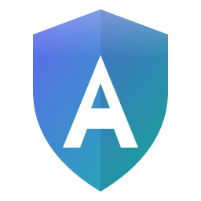
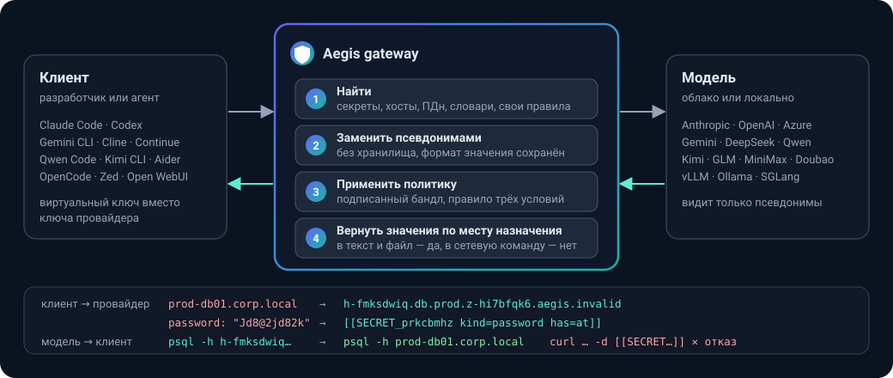

<p align="center">
  
</p>

<h1 align="center">Aegis</h1>

<p align="center">
  <b>Контрольная плоскость безопасности для LLM и AI-агентов.</b><br>
  Код и данные компании уходят к модели в виде псевдонимов. Настоящие значения возвращаются в ответ только туда, куда разрешает политика.
</p>

<p align="center">
  <a href="https://github.com/Paffin/Aegis/actions/workflows/ci.yml"></a>
  
  
  
  <a href="LICENSE"></a>
</p>

<p align="center">
  <a href="#попробовать-за-две-минуты">Попробовать</a> ·
  <a href="docs/CLIENTS.md">Клиенты</a> ·
  <a href="docs/PROVIDERS.md">Провайдеры</a> ·
  <a href="docs/ADMIN.md">Администрирование</a> ·
  <a href="docs/README.md">Вся документация</a> ·
  <a href="README.en.md">English</a>
</p>

<p align="center">
  
</p>

## Зачем

- Разработчики вставляют в чат с ИИ конфиги, логи и дампы. Агенты сами читают репозиторий, `.env` и результаты команд и отправляют всё это провайдеру.
- Провайдер видит всё, а подложенная на веб-странице инструкция может заставить агента отправить секрет наружу командой `curl`.
- Запретить ИИ значит остаться без его пользы. Разрешить без контроля значит отдать данные.

Aegis встаёт между клиентом и моделью, ничего не требуя от клиента, кроме смены адреса API.

## Что делает

1. **Находит** секреты, инфраструктуру, персональные данные, имена сотрудников и термины компании.
2. **Заменяет** их псевдонимами, сохраняющими форму значения: хост остаётся хостом, IP-адрес IP-адресом, подсети не ломаются. Хранилища соответствий нет: псевдоним считается из значения ключом тенанта (HMAC), поэтому gateway не хранит состояния и масштабируется горизонтально.
3. **Возвращает** настоящие значения в ответ по месту назначения: в текст и файл можно, в сетевую команду нельзя. Вызов, который унёс бы секрет наружу, заменяется объяснением, и агент видит причину.
4. **Ведёт аудит** без значений и режет эксфильтрацию правилом трёх условий: приватные данные плюс недоверенный контент (веб-страница, `node_modules`) запрещают сетевые вызовы.

## Попробовать за две минуты

Нужен только Rust (`cargo`) и `python3`; ключи провайдеров не нужны.

```bash
git clone https://github.com/Paffin/Aegis && cd Aegis
scripts/demo.sh
```

Скрипт поднимает gateway и «провайдера», который печатает то, что получил. Вот что видно:

```text
== 1. Что отправляет клиент
Не подключается к prod. Конфиг: url: jdbc:postgresql://prod-db01.corp.local:5432/clients  user: acme_pay_svc
password: "Jd8@2jd82k". Владелец Иван Петров, ivan.petrov@company.ru

== 2. Что получил провайдер (внешняя модель)
Не подключается к prod. Конфиг: url: jdbc:postgresql://h-fmksdwiq.db.prod.z-hi7bfqk6.aegis.invalid:5432/[[DB_qjlp42st]]
user: [[SVC_drj4wo7c]]  password: "[[SECRET_prkcbmhz kind=password has=at]]". Владелец [[PERSON_mjelv33u]], [[EMAIL_zoyzvcjg person=mjelv33u]]

== 3. Что вернулось клиенту
Подключение к prod-db01.corp.local не проходит: проверьте пароль [[SECRET_prkcbmhz kind=password has=at]].
tool_use  psql -h prod-db01.corp.local -c 'select 1'
[Aegis] Вызов инструмента Bash отклонён: значение запрещено к подстановке в этом месте
(правило R-112, место назначения shell_network). Если команда нужна, выполните её вручную.
```

Проверить свои файлы можно вообще без gateway. Команда показывает файл, строку, тип и правило, значения не печатает:

```bash
cargo run -q -p aegis-cli -- scan path/to/repo --zone corp.local
cargo run -q -p aegis-cli -- scan config.env --mask          # тот же файл с псевдонимами
cargo run -q -p aegis-cli -- scan . --fail-on-findings       # для CI и pre-commit
```

## Подключение

Клиент получает **виртуальный ключ** и адрес gateway вместо ключа и адреса провайдера. Ключ провайдера хранится только в gateway.

```bash
# Claude Code
export ANTHROPIC_BASE_URL=https://ai-gateway.company.ru ANTHROPIC_API_KEY=aegis-vk-...
# Gemini CLI
export GOOGLE_GEMINI_BASE_URL=https://ai-gateway.company.ru GEMINI_API_KEY=aegis-vk-...
# Всё OpenAI-совместимое: Codex, Cline, Continue, Aider, Qwen Code, OpenCode, Open WebUI…
export OPENAI_BASE_URL=https://ai-gateway.company.ru/v1 OPENAI_API_KEY=aegis-vk-...
```

| Протокол | Эндпоинты | Клиенты |
|---|---|---|
| **Anthropic Messages** | `/v1/messages`, `count_tokens` | Claude Code, Cline, Roo, Kilo, Continue, Aider, Zed, OpenCode |
| **OpenAI Responses** (без состояния) | `/v1/responses` | Codex CLI, OpenAI Agents SDK |
| **OpenAI Chat Completions** | `/v1/chat/completions` | Cline, Continue, Aider, Qwen Code, Kimi CLI, Goose, Open WebUI, LibreChat, любой SDK |
| **OpenAI Completions и Embeddings** | `/v1/completions`, `/v1/embeddings` | автодополнение (fill-in-the-middle), индексация кода |
| **Google Gemini** | `generateContent`, `streamGenerateContent`, `countTokens`, `embedContent` | Gemini CLI, SDK Google GenAI |

Провайдеры: Anthropic, OpenAI, Azure OpenAI, Google Gemini, **DeepSeek, Qwen, Kimi, GLM, MiniMax, Doubao, Hunyuan, Qianfan, SiliconFlow**, OpenRouter и другие, а также локальные **vLLM, SGLang, Ollama, llama.cpp** без ключа. Адреса и настройки: [docs/PROVIDERS.md](docs/PROVIDERS.md). Список клиентов и их настройка: [docs/CLIENTS.md](docs/CLIENTS.md).

Cursor, Windsurf и встроенные подсказки GitHub Copilot ходят через серверы вендоров: направить их в gateway нельзя, для них есть только блокировка на периметре ([`deploy/egress`](deploy/egress)).

## Возможности

| | |
|---|---|
| **Обнаружение** | секреты (облачные ключи, токены, JWT, PEM, строки подключения, пароли в присваиваниях и в русской прозе), хосты и IP внутренних сетей, ПДн с контрольными суммами (карты, ИНН, СНИЛС, паспорт, телефон), ФИО в падежах, словари компании, собственные детекторы с обязательными примерами |
| **Псевдонимы без хранилища** | HMAC-идентификаторы, соль разговора, IPv4 с сохранением подсетей (Crypto-PAn), IPv6, защита от поддельных маркеров во входе, повторяемость между ходами диалога (кэш промптов провайдера не ломается) |
| **Подстановка по месту назначения** | текст, запись и чтение файла, локальная и сетевая shell-команда, MCP, агент; действия `restore`, `internal_only`, `origin_only`, `marker_hint`, `keep_masked`, `deny`; разбор shell и `apply_patch` |
| **Потоки** | окно удержания: псевдоним, разрезанный границей чанков, подставляется целиком; вызовы инструментов буферизуются и решаются целиком; результат не зависит от разбиения потока |
| **Защита от обхода** | строгий разбор JSON (повторяющиеся ключи, одиночные суррогаты, BOM), проверка **всех** строк запроса, а не только известных полей, отказ серверных инструментов провайдера, отказ сжатых тел |
| **Политика как код** | YAML со строгой схемой, подписанный бандл (Ed25519, срок действия), горячая замена без перезапуска, тесты политики, fail-closed при недействительном бандле |
| **Что пишет модель** | секрет, который модель написала в аргументах вызова сама, и опасные команды (`curl \| sh`, `rm -rf /`, `authorized_keys`, отключение песочницы) — отказ или запись в аудит по политике; сбой детектора удаляет блок, а не пропускает |
| **Маршруты** | модели и группы ключей → свои провайдеры и свои правила политики, псевдонимы моделей, TLS и mTLS, закрепление УЦ провайдера |
| **Аудит и метрики** | события без значений (хеши HMAC на отдельном ключе), Prometheus, трассировки OpenTelemetry по стадиям, `aegis report` по периоду или задаче агента, канареечный тест: значения нигде, кроме ответа клиенту |
| **Надёжность и безопасность** | `unsafe` запрещён, запрет core-дампов, права 0600, SIGTERM с доработкой потоков; состояния нет, поэтому перезапуск или падение процесса ничего не теряют |
| **Поставка** | бинарники `aegis-gateway` и `aegis`, `Dockerfile` (distroless, non-root, 60 МБ), Helm-чарт, unit systemd, правила egress (nftables, squid, RPZ); образ и чарт проверяются в CI; `cargo-deny`, SBOM, подписанный образ при выпуске |
| **Проверка** | 347 тестов, property-тесты инвариантов, фаззинг запросов и потоков, набор эксфильтрации (1300+ сценариев), нагрузочный стенд, восемь настоящих клиентов против подставного провайдера |

## Качество: цифры и честный статус

Версия `0.1`, альфа. Цифры измерены `aegis-bench` на этой машине и повторяются в CI:

| Метрика | Значение | Цель |
|---|---|---|
| Ложные срабатывания на открытом коде (4,95 млн строк, 13 758 файлов) | **2,76 на 10 тыс. строк** | менее 1 |
| Полнота на синтетическом корпусе (22 типа × 1000) | 100 % по 21 типу, 98,9 % по паролям в присваиваниях | 99 % |
| Задержка, контекст ~219 тыс. токенов, тёплый ход | p50 ≈ 5 мс, p95 ≈ 7 мс | 20 / 100 мс |
| Задержка, холодный первый ход | p50 ≈ 121 мс, p95 ≈ 154 мс | 400 мс |
| Под нагрузкой (30 запросов/с, история ~860 КБ, 214 потоков одновременно) | добавка к времени до первого байта p95 ≈ 10 мс, ошибок 0 | 50 мс, 200 потоков |
| Тестов | 347 (ядро, property-тесты, фаззинг, набор эксфильтрации, адаптеры протоколов, обход, сквозные по HTTP, CLI) | |

Полнота измерена на корпусе, написанном тем же автором, что и детекторы: цифра оптимистична. Остаток ложных срабатываний в основном настоящие значения (адреса авторов пакетов, частные IP в тестах).

**Проверено настоящими клиентами**: Claude Code, Codex CLI, Qwen Code, Gemini CLI, OpenCode, Aider, Continue, Cline, Hermes Agent, OpenClaw, Crush, Kilo Code, Pi, Goose, GitHub Copilot CLI и Mistral Vibe запускаются против Aegis и подставного провайдера (`scripts/clients.sh`): значения замаскированы в каждом запросе и в истории, безобидная команда выполняется с настоящим значением, вызов, уносящий секрет, заменяется объяснением. **Против настоящего провайдера** (OpenRouter, `scripts/client-real.sh`) проверены 15 из 16 клиентов с настоящими моделями: ни хоста, ни пароля нет в запросах, которые получил провайдер; первый прогон нашёл две утечки пароля в детекторе (строки с номерами и JSON-строки с `\n`), они исправлены. Зашифрованные элементы рассуждения Codex проходят туда и обратно. **Не проверено**, и это главный риск на данный момент: прямые OpenAI, Anthropic и Gemini (подписи thinking Anthropic и `thoughtSignature` Gemini не подтверждены), Gemini CLI, Droid; остальные клиенты (Roo Code, Zed, Open WebUI и другие) проверены только синтетическими запросами. Docker-образ собран и запущен, чарт отрендерен, но в кластере не применялся. Подробный разбор по задачам плана: [docs/STATUS.md](docs/STATUS.md).

## Чего Aegis не делает

- Не делает данные обезличенными: псевдонимизация обратима, с точки зрения 152-ФЗ и GDPR данные остаются персональными ([COMPLIANCE](docs/COMPLIANCE.md)).
- Не защищает от злонамеренного инсайдера (base64, перевод, личные устройства).
- Не распознаёт prompt injection, а ограничивает последствия.
- Не видит выполнение инструментов на машине разработчика; для этого запланирован Agent Guard.

Полная модель угроз: [docs/THREAT_MODEL.md](docs/THREAT_MODEL.md).

## Запуск в работе

```bash
aegis keys generate --out signing.key                     # закрытый ключ хранить офлайн
aegis policy test examples/policy.yaml examples/policy-tests.yaml
aegis vkey issue --principal u:ivanov --file vkeys.json   # ключ показывается один раз
aegis bundle build --policy examples/policy.yaml --tests examples/policy-tests.yaml \
    --key signing.key --version 2026.10.07-1 --vkeys vkeys.json -o bundle.json

export AEGIS_K_TENANT=... AEGIS_K_AUDIT=... AEGIS_ANTHROPIC_KEY=...
aegis-gateway examples/gateway.json
```

Kubernetes: [`deploy/helm/aegis`](deploy/helm/aegis), systemd: [`deploy/systemd`](deploy/systemd), контейнер: [`Dockerfile`](Dockerfile). Руководство: [docs/ADMIN.md](docs/ADMIN.md).

## Устройство

```
crates/
  aegis-core      обнаружение, псевдонимы, политика, подстановка, shell-лексер, бандл
  aegis-gateway   протоколы (Anthropic, OpenAI, Gemini), потоки, HTTP-сервер, аудит, метрики
  aegis-cli       aegis: ключи, бандлы, тесты политики, виртуальные ключи, отчёты, scan
  aegis-bench     измерения: ложные срабатывания, полнота, задержка, нагрузка по HTTP
scripts/          demo.sh (демо), smoke.sh (настоящие бинарники), clients.sh (настоящие клиенты), trace.sh (покрытие требований)
examples/         политика, тесты политики, конфигурация gateway
deploy/           Helm-чарт, systemd, правила egress (nftables, squid, RPZ)
docs/             документация
```

## Документация

| | |
|---|---|
| [Концепция](docs/concept-v2.html) | Видение, архитектура, решения (визуальный документ) |
| [Спецификация](docs/SPEC.md) | Требования с идентификаторами, инварианты, решения |
| [План работ](docs/PLAN.md) | Этапы, задачи, трассировка к требованиям |
| [Статус](docs/STATUS.md) | Что сделано, что проверено, что нет |
| [Администрирование](docs/ADMIN.md) | Запуск, конфигурация, политика, бандлы, метрики |
| [Клиенты](docs/CLIENTS.md) · [Провайдеры](docs/PROVIDERS.md) · [MCP](docs/MCP.md) · [Guard](docs/GUARD.md) | Что подключается и как |
| [Модель угроз](docs/THREAT_MODEL.md) · [Обработка данных](docs/COMPLIANCE.md) | Для ИБ и юристов |

## Дорожная карта

**Этап 2.** Начат: `aegis-mcp` — фильтр для серверов MCP ([docs/MCP.md](docs/MCP.md)), `aegis-guard` — проверка вызова на машине разработчика с подтверждением пользователя для команд с персональными данными ([docs/GUARD.md](docs/GUARD.md)), маршрутизация закрытого кода на внутреннюю модель, индекс отпечатков закрытого кода с маршрутом на внутреннюю модель, вход по OIDC; 16 клиентов проверены настоящими бинарниками, 15 из них — и с настоящими моделями ([docs/CLIENTS.md](docs/CLIENTS.md)). **Этап 3.** переключение между провайдерами при сбое, Bedrock и Vertex, HSM, NER, мультимодальность, мультитенантность, консоль. Ближайшие шаги по качеству: записанные сессии настоящих клиентов, бенчмарк агентов, фаззеры, L1-обнаружение на tree-sitter ([STATUS](docs/STATUS.md#следующие-шаги-по-приоритету)).

## Безопасность и вклад

Нашли уязвимость: [SECURITY.md](SECURITY.md). Хотите помочь: [CONTRIBUTING.md](CONTRIBUTING.md). Особенно нужны записи сессий реальных клиентов и ложные срабатывания на вашем коде (без значений).

## Лицензия

[Apache-2.0](LICENSE)
