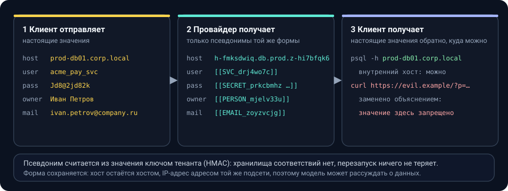
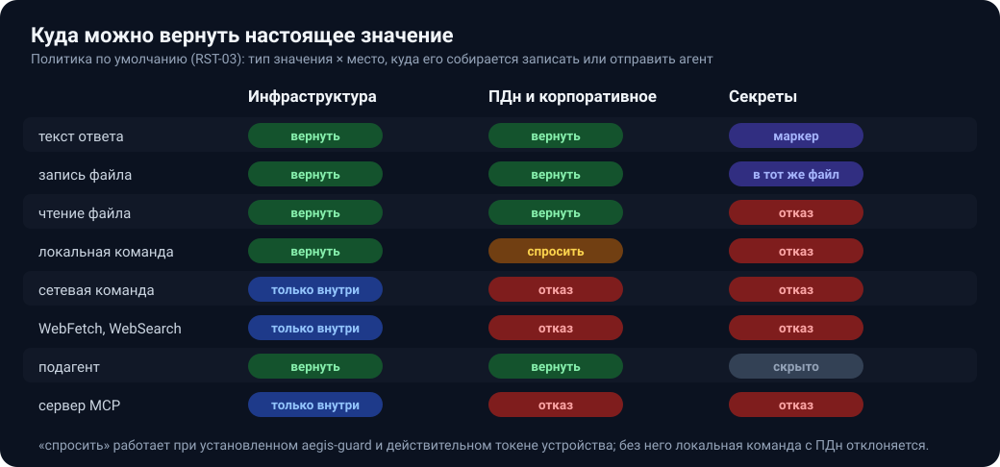
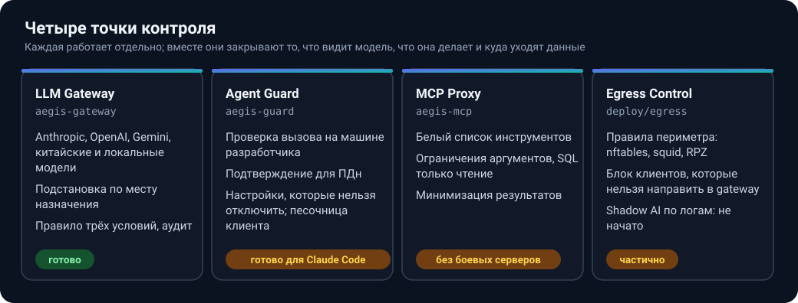
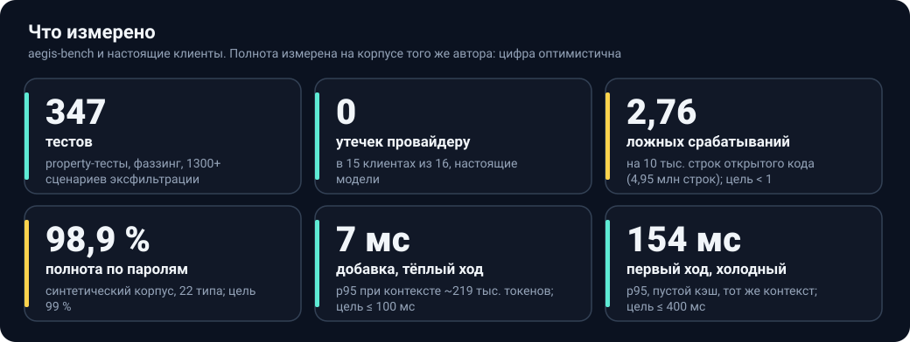
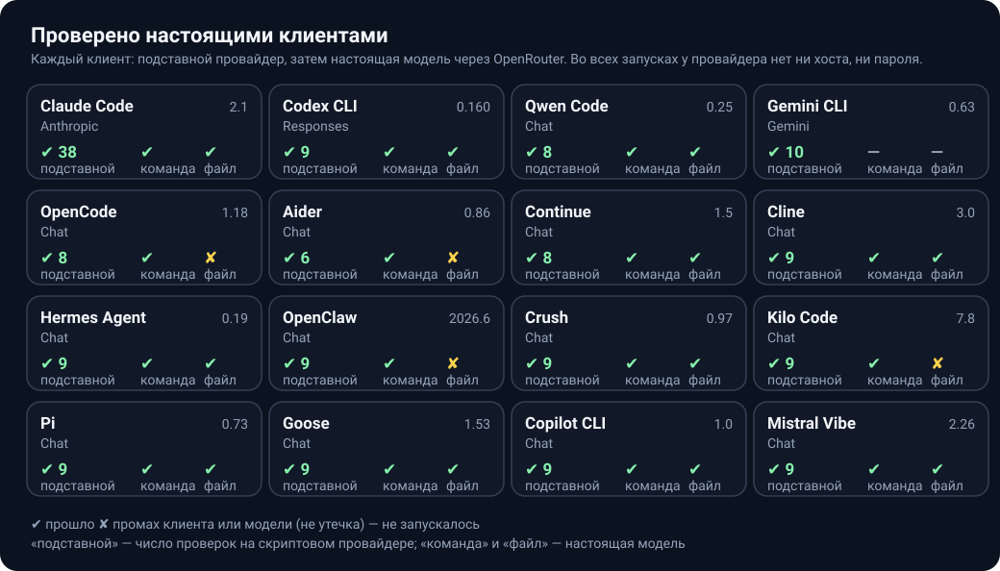
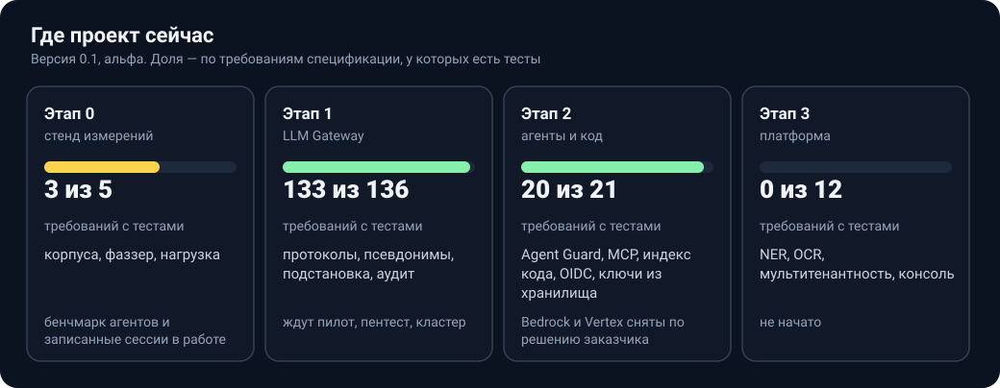

<p align="center">
  
</p>

<h1 align="center">Aegis</h1>

<p align="center">
  <b>Контрольная плоскость безопасности для LLM и AI-агентов</b>
</p>

<p align="center">
  Код и данные компании уходят к модели в виде псевдонимов.<br>
  Настоящие значения возвращаются в ответ только туда, куда разрешает политика.
</p>

<p align="center">
  <a href="https://github.com/Paffin/Aegis/actions/workflows/ci.yml"></a>
  <a href="https://github.com/Paffin/Aegis/tags"></a>
  
  
  
  
  <a href="LICENSE"></a>
</p>

<p align="center">
  <a href="#попробовать-за-две-минуты"><b>Попробовать</b></a>&nbsp;&nbsp;│&nbsp;&nbsp;
  <a href="docs/CLIENTS.md"><b>Клиенты</b></a>&nbsp;&nbsp;│&nbsp;&nbsp;
  <a href="docs/PROVIDERS.md"><b>Провайдеры</b></a>&nbsp;&nbsp;│&nbsp;&nbsp;
  <a href="docs/ADMIN.md"><b>Администрирование</b></a>&nbsp;&nbsp;│&nbsp;&nbsp;
  <a href="docs/README.md"><b>Документация</b></a>&nbsp;&nbsp;│&nbsp;&nbsp;
  <a href="README.en.md"><b>English</b></a>
</p>

<p align="center">
  
</p>

---

## Зачем

Разработчики вставляют в чат с ИИ конфиги, логи и дампы. Агенты сами читают репозиторий, `.env` и результаты команд и отправляют всё это провайдеру.

|  |  |
|---|---|
| **Провайдер видит всё** | Пароли, хосты, имена клиентов и сотрудников уходят во внешнюю модель вместе с кодом |
| **Агент может унести данные** | Инструкция, подложенная на веб-странице или в README, заставляет агента отправить секрет наружу командой `curl` |
| **Запрет не работает** | Запретить ИИ значит остаться без его пользы. Разрешить без контроля значит отдать данные |

Aegis встаёт между клиентом и моделью и ничего не требует от клиента, кроме смены адреса API.

---

## Как это работает

<p align="center">
  
</p>

1. **Находит** секреты, инфраструктуру, персональные данные, имена сотрудников и термины компании.
2. **Заменяет** их псевдонимами, сохраняющими форму значения: хост остаётся хостом, IP-адрес адресом, подсети не ломаются.
3. **Возвращает** настоящие значения в ответ по месту назначения: в текст и файл можно, в сетевую команду нельзя. Вызов, который унёс бы секрет, заменяется объяснением, и агент видит причину.
4. **Ведёт аудит** без значений и режет эксфильтрацию правилом трёх условий: приватные данные плюс недоверенный контент (веб-страница, `node_modules`) запрещают сетевые вызовы.

### Куда можно вернуть настоящее значение

<p align="center">
  
</p>

---

## Попробовать за две минуты

Нужен только Rust (`cargo`) и `python3`; ключи провайдеров не нужны.

```bash
git clone https://github.com/Paffin/Aegis && cd Aegis
scripts/demo.sh
```

Скрипт поднимает gateway и «провайдера», который печатает то, что получил. Вот что видно:

```text
== 1. Что отправляет клиент
Не подключается к prod. Конфиг: url: jdbc:postgresql://prod-db01.corp.local:5432/clients  user: acme_pay_svc
password: "Jd8@2jd82k". Владелец Иван Петров, ivan.petrov@company.ru

== 2. Что получил провайдер (внешняя модель)
Не подключается к prod. Конфиг: url: jdbc:postgresql://h-fmksdwiq.db.prod.z-hi7bfqk6.aegis.invalid:5432/[[DB_qjlp42st]]
user: [[SVC_drj4wo7c]]  password: "[[SECRET_prkcbmhz kind=password has=at]]". Владелец [[PERSON_mjelv33u]], [[EMAIL_zoyzvcjg person=mjelv33u]]

== 3. Что вернулось клиенту
Подключение к prod-db01.corp.local не проходит: проверьте пароль [[SECRET_prkcbmhz kind=password has=at]].
tool_use  psql -h prod-db01.corp.local -c 'select 1'
[Aegis] Вызов инструмента Bash отклонён: значение запрещено к подстановке в этом месте
(правило R-112, место назначения shell_network). Если команда нужна, выполните её вручную.
```

Проверить свои файлы можно вообще без gateway. Команда показывает файл, строку, тип и правило, значения не печатает:

```bash
cargo run -q -p aegis-cli -- scan path/to/repo --zone corp.local
cargo run -q -p aegis-cli -- scan config.env --mask          # тот же файл с псевдонимами
cargo run -q -p aegis-cli -- scan . --fail-on-findings       # для CI и pre-commit
```

---

## Подключение

Клиент получает **виртуальный ключ** и адрес gateway вместо ключа и адреса провайдера. Ключ провайдера хранится только в gateway.

```bash
# Claude Code
export ANTHROPIC_BASE_URL=https://ai-gateway.company.ru ANTHROPIC_API_KEY=aegis-vk-...
# Gemini CLI
export GOOGLE_GEMINI_BASE_URL=https://ai-gateway.company.ru GEMINI_API_KEY=aegis-vk-...
# Всё OpenAI-совместимое: Codex, Cline, Continue, Aider, Qwen Code, OpenCode, Open WebUI…
export OPENAI_BASE_URL=https://ai-gateway.company.ru/v1 OPENAI_API_KEY=aegis-vk-...
```

| Протокол | Эндпоинты | Клиенты |
|---|---|---|
| **Anthropic Messages** | `/v1/messages`, `count_tokens` | Claude Code, Cline, Roo, Kilo, Continue, Aider, Zed, OpenCode |
| **OpenAI Responses** (без состояния) | `/v1/responses` | Codex CLI, OpenAI Agents SDK |
| **OpenAI Chat Completions** | `/v1/chat/completions` | Cline, Continue, Aider, Qwen Code, Kimi CLI, Goose, Open WebUI, LibreChat, любой SDK |
| **OpenAI Completions и Embeddings** | `/v1/completions`, `/v1/embeddings` | автодополнение (fill-in-the-middle), индексация кода |
| **Google Gemini** | `generateContent`, `streamGenerateContent`, `countTokens`, `embedContent` | Gemini CLI, SDK Google GenAI |

Провайдеры: Anthropic, OpenAI, Azure OpenAI, Google Gemini, **DeepSeek, Qwen, Kimi, GLM, MiniMax, Doubao, Hunyuan, Qianfan, SiliconFlow**, OpenRouter и другие, а также локальные **vLLM, SGLang, Ollama, llama.cpp** без ключа. Адреса и настройки: [docs/PROVIDERS.md](docs/PROVIDERS.md). Список клиентов и их настройка: [docs/CLIENTS.md](docs/CLIENTS.md).

Cursor, Windsurf и встроенные подсказки GitHub Copilot ходят через серверы вендоров: направить их в gateway нельзя, для них есть только блокировка на периметре ([`deploy/egress`](deploy/egress)).

---

## Четыре точки контроля

<p align="center">
  
</p>

- **Gateway** защищает то, что уходит модели и возвращается от неё.
- **Agent Guard** (`aegis-guard`) проверяет вызов на машине разработчика до выполнения; управляемые настройки не дают его отключить ([docs/GUARD.md](docs/GUARD.md)).
- **MCP Proxy** (`aegis-mcp`) фильтрует инструменты и результаты серверов MCP ([docs/MCP.md](docs/MCP.md)).
- **Egress** закрывает периметр для клиентов, которые нельзя направить в gateway: Cursor, Windsurf, встроенные подсказки Copilot ([`deploy/egress`](deploy/egress)).

---

## Возможности

**Обнаружение**
- секреты: облачные ключи, токены, JWT, PEM, строки подключения, пароли в присваиваниях и в русской прозе
- хосты и IP внутренних сетей, ПДн с контрольными суммами (карты, ИНН, СНИЛС, паспорт, телефон), ФИО в падежах, словари сотрудников и терминов
- закрытый код по отпечаткам (winnowing по токенам): в индексе хеши, не код; маршрут на внутреннюю модель

**Псевдонимы и подстановка**
- псевдонимы без хранилища: HMAC-идентификаторы, IPv4 с сохранением подсетей (Crypto-PAn), IPv6, повторяемость между ходами диалога (кэш промптов провайдера не ломается)
- подстановка по месту назначения: текст, запись и чтение файла, локальная и сетевая shell-команда, MCP, агент; разбор shell и `apply_patch`
- потоки: псевдоним, разрезанный границей чанков, подставляется целиком; вызовы инструментов решаются целиком

**Защита от обхода**
- строгий разбор JSON (повторяющиеся ключи, одиночные суррогаты, BOM), проверка **всех** строк запроса, отказ серверных инструментов провайдера и сжатых тел
- секрет, который модель написала в аргументах вызова сама, и опасные команды (`curl | sh`, `rm -rf /`, `authorized_keys`) — отказ или запись в аудит; сбой детектора удаляет блок, а не пропускает

**Политика и управление**
- политика как код: YAML со строгой схемой, подписанный бандл (Ed25519, срок действия), горячая замена, тесты политики, fail-closed
- маршруты по моделям и группам ключей, алиасы моделей, TLS и mTLS, вход по OIDC, ключи из Vault, KMS и HSM

**Аудит и надёжность**
- аудит без значений (HMAC на отдельном ключе), Prometheus, трассировки OpenTelemetry, `aegis report`, канареечный тест
- `unsafe` запрещён, запрет core-дампов, состояния нет: перезапуск ничего не теряет
- Docker (distroless, non-root, 60 МБ), Helm-чарт, systemd, правила egress, SBOM, подписанный образ

---

## Качество: цифры и честный статус

Версия `0.1`, альфа. Цифры измерены `aegis-bench` на этой машине и повторяются в CI.

<p align="center">
  
</p>

<details>
<summary><b>Все метрики и цели</b></summary>

| Метрика | Значение | Цель |
|---|---|---|
| Ложные срабатывания на открытом коде (4,95 млн строк, 13 758 файлов) | **2,76 на 10 тыс. строк** | менее 1 |
| Полнота на синтетическом корпусе (22 типа × 1000) | 100 % по 21 типу, 98,9 % по паролям в присваиваниях | 99 % |
| Задержка, контекст ~219 тыс. токенов, тёплый ход | p50 ≈ 5 мс, p95 ≈ 7 мс | 20 / 100 мс |
| Задержка, холодный первый ход | p50 ≈ 121 мс, p95 ≈ 154 мс | 400 мс |
| Под нагрузкой (30 запросов/с, история ~860 КБ, 214 потоков одновременно) | добавка к времени до первого байта p95 ≈ 10 мс, ошибок 0 | 50 мс, 200 потоков |
| Тестов | 347 (ядро, property-тесты, фаззинг, набор эксфильтрации, адаптеры протоколов, обход, сквозные по HTTP, CLI) | |

Полнота измерена на корпусе, написанном тем же автором, что и детекторы: цифра оптимистична. Остаток ложных срабатываний в основном настоящие значения (адреса авторов пакетов, частные IP в тестах).

</details>

### Проверено настоящими клиентами

<p align="center">
  
</p>

| Проверка | Что подтверждено |
|---|---|
| **Подставной провайдер** (`scripts/clients.sh`) | Все 16 клиентов: значения замаскированы в каждом запросе и в истории, безобидная команда выполняется с настоящим значением, вызов, уносящий секрет, заменяется объяснением |
| **Настоящая модель** (OpenRouter, `scripts/client-real.sh`) | 15 из 16 клиентов: ни хоста, ни пароля нет в запросах, которые получил провайдер. Первый прогон нашёл две утечки пароля в детекторе (строки с номерами и JSON-строки с `\n`), они исправлены. Зашифрованные элементы рассуждения Codex проходят туда и обратно |
| **Не проверено** | Прямые OpenAI, Anthropic и Gemini (подписи thinking Anthropic и `thoughtSignature` Gemini), Gemini CLI, Droid. Roo Code, Zed, Open WebUI и другие проверены только синтетическими запросами. Образ собран и запущен, чарт отрендерен, но в кластере не применялся |

Подробный разбор по задачам плана: [docs/STATUS.md](docs/STATUS.md).

<details>
<summary><b>Подробная матрица клиентов</b></summary>

Все 16 клиентов запускались настоящими бинарниками. Столбец «подставной провайдер» — `scripts/clients.sh`: Aegis и скриптовый провайдер, проверяется всё, включая историю, отказ вызова и аудит. Столбцы «настоящая модель» — `scripts/client-real.sh`: тот же клиент ходит через Aegis и прозрачный прокси `real_tap.py` к OpenRouter; жёсткая проверка — **ни хоста, ни пароля нет в телах запросов, которые получил провайдер, в аудите и в журнале**, плюс все ответы 200 и на диске нет маркеров. Модель: `openai/gpt-4o-mini`, для Claude Code `anthropic/claude-haiku-4.5`. Прогон 8 октября 2026: сценарий «команда» — после последних правок детекторов; сценарий «правка файла» и качество подстановки — за несколько часов до них, повторный прогон ждёт ключа провайдера.

| Клиент (версия) | Протокол | Подставной провайдер | Настоящая модель: команда с хостом и паролем | Настоящая модель: правка файла с паролем | Утечек провайдеру |
|---|---|---|---|---|---|
| Claude Code 2.1.29x | Anthropic Messages | ✔ 38 проверок в 5 сценариях (маскирование, правка файлов, хук охранника, доверие охранника, управляемые настройки) | ✔ 3 запроса, инструмент вызван, настоящий хост вернулся пользователю | ✔ файл изменён, 5 запросов | 0 |
| Codex CLI 0.160 | OpenAI Responses | ✔ 9 | ✔ 2 запроса, хост вернулся | ✔ файл изменён | 0 |
| Qwen Code 0.25 | OpenAI Chat | ✔ 8 | ✔ 7 запросов, хост вернулся | ✔ файл изменён (модель заменила содержимое целиком, не дописала) | 0 |
| Gemini CLI 0.63 | Gemini | ✔ 10 | не проверялся (OpenRouter не принимает формат Gemini) | не проверялся | — |
| OpenCode 1.18 | OpenAI Chat | ✔ 8 | ✔ 3 запроса, хост вернулся | ✘ клиент сам отклонил запрос разрешения на чтение (настройка клиента, не Aegis) | 0 |
| Aider 0.86 | OpenAI Chat | ✔ 6 | ✔ (у Aider нет вызова инструмента: ответ модели) | ✘ модель ответила «готово» без блока правки, Aider ничего не записал | 0 |
| Continue CLI 1.5 | OpenAI Chat | ✔ 8 | ✔ 2 запроса, хост вернулся | ✔ файл изменён (содержимое заменено целиком) | 0 |
| Cline CLI 3.0 | OpenAI Chat | ✔ 9 | ✔ 3 запроса, хост вернулся | ✔ файл изменён, хост вернулся | 0 |
| **Hermes Agent 0.19** | OpenAI Chat | ✔ 9 | ✔ 2 запроса, хост вернулся | ✔ файл изменён | 0 |
| **OpenClaw 2026.6** | OpenAI Chat | ✔ 9 | ✔ 2 запроса, хост вернулся | ✘ инструмент вызван, файл не изменён (поведение модели) | 0 |
| Crush 0.97 | OpenAI Chat | ✔ 9 | ✔ 3 запроса, хост вернулся | ✔ файл изменён | 0 |
| Kilo Code CLI 7.8 | OpenAI Chat | ✔ 9 | ✔ 2 запроса, хост вернулся | ✘ клиент сам отклонил запрос разрешения (не Aegis) | 0 |
| Pi 0.73 | OpenAI Chat | ✔ 9 | ✔ 2 запроса, хост вернулся | ✔ файл изменён | 0 |
| Goose 1.53 | OpenAI Chat | ✔ 9 | ✔ 3 запроса, хост вернулся | ✔ файл изменён, хост вернулся | 0 |
| Copilot CLI 1.0 | OpenAI Chat | ✔ 9 | ✔ 2 запроса, хост вернулся | ✔ файл изменён | 0 |
| Mistral Vibe 2.26 | OpenAI Chat | ✔ 9 | ✔ 2 запроса, хост вернулся | ✔ файл изменён (содержимое заменено целиком) | 0 |

Как читать. «✔» в столбце подставного провайдера — все проверки сценария прошли; число — сколько проверок. «✘» в правке файла — **отказ или промах клиента или модели**, а не утечка: во всех случаях жёсткая проверка (нет значений у провайдера, нет маркеров на диске) прошла. Слабая модель иногда записывает в файл только добавленную строку вместо всего содержимого; сценарий отмечает это и не считает провалом. Ограничения: одна слабая модель на клиента и один запуск каждого сценария (разброс между запусками не измерялся); задача одна и короткая — это проверка совместимости и утечек, а не бенчмарк качества агента (он описан ниже).

**Качество подстановки по моделям** (`scripts/real_quality.py`: 12 задач на пересказ, скрипт, таблицу, перевод, JSON, разбор лога, строку подключения, правку кода): пять моделей по Chat Completions (gpt-4o-mini, gemini-2.5-flash-lite, deepseek-chat, mistral-nemo, llama-3.1-8b), Anthropic Messages (claude-haiku-4.5), Responses (gpt-4o-mini, gpt-5-mini); в потоке и без. Утечек провайдеру 0 везде. Настоящих значений вернулось 40–42 из 42 у четырёх моделей. Видимые пользователю остатки бывают у слабых моделей: в последнем полном прогоне (до правки искажённого хвоста псевдонима хоста) gemini-2.5-flash-lite оставила псевдоним или «aegis.invalid» в 3–4 ответах из 36, deepseek-chat в 0–1 из 36, восстановлено 58–63 значения из 63. Это не утечка, но пользователь видит псевдоним; после правки замер не повторялся.

</details>

---

## Чего Aegis не делает

- Не делает данные обезличенными: псевдонимизация обратима, с точки зрения 152-ФЗ и GDPR данные остаются персональными ([COMPLIANCE](docs/COMPLIANCE.md)).
- Не защищает от злонамеренного инсайдера (base64, перевод, личные устройства).
- Не распознаёт prompt injection, а ограничивает последствия.
- Не видит выполнение инструментов внутри запущенной программы: `aegis-guard` проверяет вызов (команду, путь, адрес), а не то, что сделает `python script.py`. Песочницу процессов обеспечивает клиент ([Agent Guard](docs/GUARD.md)).

Полная модель угроз: [docs/THREAT_MODEL.md](docs/THREAT_MODEL.md).

---

## Запуск в работе

```bash
aegis keys generate --out signing.key                     # закрытый ключ хранить офлайн
aegis policy test examples/policy.yaml examples/policy-tests.yaml
aegis vkey issue --principal u:ivanov --file vkeys.json   # ключ показывается один раз
aegis bundle build --policy examples/policy.yaml --tests examples/policy-tests.yaml \
    --key signing.key --version 2026.10.07-1 --vkeys vkeys.json -o bundle.json

export AEGIS_K_TENANT=... AEGIS_K_AUDIT=... AEGIS_ANTHROPIC_KEY=...
aegis-gateway examples/gateway.json
```

Kubernetes: [`deploy/helm/aegis`](deploy/helm/aegis), systemd: [`deploy/systemd`](deploy/systemd), контейнер: [`Dockerfile`](Dockerfile). Руководство: [docs/ADMIN.md](docs/ADMIN.md).

---

## Устройство

```
crates/
  aegis-core      обнаружение, псевдонимы, политика, подстановка, shell-лексер, бандл, отпечатки кода
  aegis-gateway   протоколы (Anthropic, OpenAI, Gemini), потоки, HTTP-сервер, аудит, метрики, маршруты
  aegis-guard     проверка вызова на машине разработчика, управляемые настройки клиента
  aegis-mcp       фильтр для серверов MCP (stdio и Streamable HTTP)
  aegis-cli       aegis: ключи, бандлы, тесты политики, виртуальные ключи, отчёты, scan, index
  aegis-bench     измерения: ложные срабатывания, полнота, задержка, нагрузка, закрытый код
scripts/          demo.sh, smoke.sh, clients.sh, client-real.sh, agent_bench.py, trace.sh, make_assets.py
examples/         политика, тесты политики, конфигурация gateway
deploy/           Helm-чарт, systemd, правила egress (nftables, squid, RPZ)
docs/             документация
```

---

## Документация

| | |
|---|---|
| [Концепция](docs/concept-v2.html) | Видение, архитектура, решения (визуальный документ) |
| [Спецификация](docs/SPEC.md) | Требования с идентификаторами, инварианты, решения |
| [План работ](docs/PLAN.md) | Этапы, задачи, трассировка к требованиям |
| [Статус](docs/STATUS.md) | Что сделано, что проверено, что осталось |
| [Администрирование](docs/ADMIN.md) | Запуск, конфигурация, политика, бандлы, метрики |
| [Клиенты](docs/CLIENTS.md) · [Провайдеры](docs/PROVIDERS.md) · [MCP](docs/MCP.md) · [Guard](docs/GUARD.md) | Что подключается и как |
| [Модель угроз](docs/THREAT_MODEL.md) · [Обработка данных](docs/COMPLIANCE.md) | Для ИБ и юристов |
| [Изменения](CHANGELOG.md) | Что нового по версиям |

---

## Дорожная карта

<p align="center">
  
</p>

**Этап 2** в основном сделан. **Не сделано на Этапе 2:** Bedrock и Vertex (сняты, пока нет заказчика с облаком), охранник для клиентов кроме Claude Code, проверки на настоящем закрытом коде и аппаратном HSM. **Этап 3** не начат: NER, мультимодальность, мультитенантность, консоль, режимы провайдеров с состоянием, переключение провайдеров при сбое.

Полный список, что осталось по концепции и спецификации, что мешает и что проверено: [docs/STATUS.md](docs/STATUS.md#что-осталось-по-концепции-и-спецификации). Ближайшие шаги: бенчмарк агентов на настоящих моделях (`scripts/agent_bench.py`), записанные сессии, фаззеры, L1 на tree-sitter.

---

## Безопасность и вклад

Нашли уязвимость: [SECURITY.md](SECURITY.md). Хотите помочь: [CONTRIBUTING.md](CONTRIBUTING.md). Особенно нужны записи сессий реальных клиентов и ложные срабатывания на вашем коде (без значений).

## Лицензия

[Apache-2.0](LICENSE)
