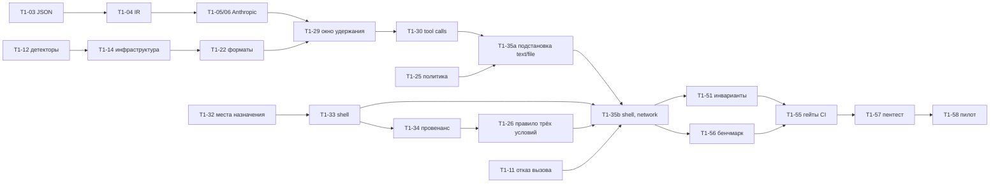

# Aegis — план работ

| | |
|---|---|
| Версия | 1.1-draft |
| Основание | [SPEC.md](SPEC.md) 1.0-draft (после ревью по концепции) |
| Статус | Черновик для обсуждения, проверен по спецификации |

---

## 1. Принципы

1. **Каждая задача ссылается на требования спецификации.** Задача без ссылки на требование не берётся в работу. Требование без задачи — дефект плана (раздел 10 проверяет покрытие).
2. **Приёмка задачи = критерии требований**, на которые она ссылается. Если в колонке «Приёмка» перечислено не всё, действует полный текст требования. Тесты помечаются идентификатором требования (`// REQ: PSE-04`), скрипт трассировки (`T0-12`) строит отчёт покрытия.
3. **Сначала риск, потом объём.** Верность протоколов и поведение клиентов при отказе проверяются в первые 8 недель (M1a), качество агента с псевдонимами — к M1b.
4. **Гейт этапа — измеримые критерии из раздела `QA` спецификации.** Этап не закрывается по календарю.

### Определение готовности задачи

- Код и модульные тесты с пометками `REQ:`.
- Для детекторов — примеры в корпусе `QA-01`, полнота и точность не ниже целевых.
- Проверка «нет значений в логах» (`SEC-01`) проходит.
- Документация обновлена, если меняется поведение для администратора или пользователя.
- Ревью кода вторым инженером; для `aegis-core`, адаптеров и подстановки — ревью с фокусом на безопасность.

---

## 2. Команда, оценки, ёмкость

**Размеры:** S — 0,5 чел.-нед., M — 2 чел.-нед., L — 4 чел.-нед. Оценки грубые, ±30 %.

**Роли в колонке «Кто»:** R — инженер Rust, Q — инженер по качеству и данным, D — DevOps и безопасность, Л — технический лидер.

**Состав, на который рассчитан план:**

| Роль | Кол-во | Занятость |
|---|---|---|
| Инженер Rust | 4 | R1–R3 — Э1 с недели 0; R4 — инструменты Э0 до недели 10, затем Э1 |
| Инженер по качеству и данным | 1 | Э0 до недели 12, затем приёмка Э1 |
| DevOps и безопасность | 0,5 | Весь период |
| Технический лидер | — | Совмещает с R1: архитектура, ревью, связь с пилотным заказчиком |

**Баланс Э1 до M1-RC (неделя 28):**

| Роль | Трудоёмкость задач | Ёмкость | Резерв |
|---|---|---|---|
| R (включая долю лидера) | ≈ 77 чел.-нед. | 3 × 28 + 18 = 102 чел.-нед. | 25 % |
| Q | ≈ 9 чел.-нед. (включая `T0-10`) | 16 чел.-нед. (недели 12–28) | 44 % |
| D | ≈ 5 чел.-нед. | 14 чел.-нед. | 60 % |

**Баланс Э0 до M0 (неделя 12):** R4 — 9 чел.-нед. при ёмкости 10; Q — 10,5 при ёмкости 12; D — 2 при ёмкости 6. Набор эксфильтрации `T0-10` выполняется Q на неделях 12–16: он нужен только к M1c. Самая длинная цепочка Э0 — `T0-02 → T0-03 → T0-06 → T0-11` (≈ 11 чел.-нед. у Q) — укладывается в 12 недель только при старте `T0-05` у R4 параллельно с `T0-03`.

Резерв Э1 закладывается на ревью, интеграцию и погрешность оценок. **Если инженеров Rust три**, а не четыре, M1-RC сдвигается примерно на неделю 36, M1 — на неделю 40.

---

## 3. Вехи

| Веха | Неделя | Критерий выхода | Требования |
|---|---|---|---|
| **M1a** · Прозрачный прокси | 8 | Все кассеты `QA-03` проходят через IR без изменений с побайтово равным результатом; подписи thinking и `encrypted_content` принимаются реальным провайдером; поведение Claude Code и Codex при отказе вызова инструмента проверено, решение записано в ADR | `PRO-01`…`PRO-06`, `IR-01`…`IR-04`, `INV-2` |
| **M0** · Стенд измерений | 12 | Критерии `QA-14`; базовые замеры агентов без Aegis записаны; допущения ДОП-1, ДОП-2 и вопросы 1, 3 раздела 15 спецификации подтверждены заказчиком (`T0-13`) | `QA-01`…`QA-03`, `QA-12`, `QA-14` |
| **M1b** · Маскирование | 18 | Детекция L0 и псевдонимизация работают; подстановка для `text` и `file_write`; первый прогон бенчмарка агентов через Aegis (риск R6); замер prompt cache (риск R7); тесты `INV-1`, `INV-3`…`INV-5` для `text` и `file_write` проходят | `DET` (L0), `PSE`, `RST-01`…`RST-05`, `RST-08`, `INV-1`, `INV-3`…`INV-5` |
| **M1c** · Безопасность | 24 | Места назначения `shell_*`, `network`, `agent`, `mcp`, `unknown`; правило трёх условий в подстановке; проверка аргументов инструментов; L1; аудит; fail-closed; `QA-06`, `QA-07`, `QA-08` проходят | `RST-06`…`RST-10`, `RSP-07`, `RSP-10`, `POL-07`, `DET-05`, `AUD`, `NFR-09`, `QA-06`…`QA-08` |
| **M1-RC** · Кандидат в релиз | 28 | Все целевые метрики `QA-05` достигнуты в CI; гейты `QA-09` включены; внешний пентест без открытых критичных и высоких находок | Все требования Э1, кроме `QA-13`; `QA-09`, `SEC-12` |
| **M1** · MVP | 32 | Пилот проведён, критерии `QA-13` выполнены | `QA-13` |
| **M2** · Агенты и код | 48 | Критерии `QA-10`; `QA-04`…`QA-08` остаются зелёными | Все требования Э2 |
| **M3** · Платформа | 74 | Критерии `QA-11` | Все требования Э3 |

Вход в Э2 (неделя 28, параллельно с пилотом) требует ответа на вопрос 2 раздела 15 спецификации: может ли заказчик ставить Agent Guard на машины разработчиков.

```mermaid
gantt
  dateFormat  X
  axisFormat  нед %s
  section Э0
  Кассеты, фаззер (R4)               :e0a, 0, 6
  Корпус, оценщик, задачи (Q)        :e0b, 0, 12
  Харнес, нагрузка (R4)              :e0c, 4, 10
  Подтверждение допущений (Л)        :e0d, 0, 4
  section Э1
  A+B Каркас и протоколы → M1a       :a, 0, 8
  C Детекция L0                      :c, 6, 18
  D Псевдонимизация                  :d, 6, 18
  E Политика, бандл, CLI             :e, 6, 16
  F1 Ответ, подстановка text/file    :f1, 10, 18
  F2 Shell, network, правило трёх    :f2, 16, 24
  C2 L1 и настройка детекции         :c2, 16, 24
  H Аудит, наблюдаемость             :h, 16, 22
  I Надёжность, производительность   :i, 18, 28
  J Поставка, документация           :j, 18, 28
  K Приёмка, пентест → M1-RC         :k, 20, 28
  Пилот → M1                         :p, 28, 32
  section Э2
  Агенты и код                       :e2, 28, 48
```

---

## 4. Этап 0 — стенд измерений

| ID | Задача | Кто | Размер | Зависит от | Требования | Приёмка |
|---|---|---|---|---|---|---|
| T0-01 | Rust workspace (`aegis-core`, `aegis-gateway`, `aegis-cli`, `aegis-bench`), CI со сборкой, тестами, `clippy`, `cargo-deny`, `cargo-audit` | R4 | S | — | `SEC-09` (часть) | CI зелёный на пустом каркасе |
| T0-02 | Интерфейс детектора в `aegis-core` (вход — блок, выход — спаны с типом); формат разметки корпуса (файл, смещения, тип); оценщик полноты и точности по типам и ложных срабатываний на 10 тыс. строк; эталонный простой детектор (ключи AWS) | R4, Q | M | T0-01 | `QA-01`, `QA-14` | Оценщик выдаёт отчёт по эталонному детектору по всем типам `DET-04` |
| T0-03 | Генератор синтетических репозиториев и конфигов со вставками всех типов `DET-04`: секреты, хосты, IP, строки подключения, ПДн, ФИО в разных падежах, email сотрудников, корпоративные имена | Q | L | T0-02 | `QA-01` | Не менее 5 тыс. размеченных вставок, не менее 100 на каждый тип |
| T0-04 | Отрицательный корпус: не менее 10 млн строк открытого кода с проверкой лицензий; lockfile'ы, хеши, UUID, фикстуры | Q, D | M | T0-02 | `QA-01` | Корпус версионирован, лицензии записаны |
| T0-05 | Харнес бенчмарка: запуск Claude Code и Codex в изолированных контейнерах, оценка по тестам задачи, режимы «напрямую» и «через прокси» | R4 | M | T0-01 | `QA-02` | Харнес прогоняет 3 пробные задачи в обоих режимах |
| T0-06 | Набор задач бенчмарка: не менее 50, из них не менее 10 с причиной бага в скрываемом значении (опечатка в зоне, спецсимвол в пароле, расхождение хостов) и не менее 10, требующих WebFetch | Q | L | T0-03, T0-05 | `QA-02` | Разброс успешности между двумя прогонами ≤ 3 п. п. |
| T0-07 | Записывающий прокси и кассеты: не менее 1000 запросов Anthropic и OpenAI (поток, thinking, `encrypted_content`, tool calls, `cache_control`) на синтетике | R4 | M | T0-01 | `QA-03` | Кассеты воспроизводятся против mock-провайдера. Готово к неделе 4: нужно для M1a |
| T0-08 | Фаззер протоколов: корректные и искажённые запросы и потоки SSE (порядок событий, разрезанные чанки, неизвестные поля и события) | R4 | M | T0-07 | `QA-12` | Запускается в CI против mock-провайдера |
| T0-09 | Нагрузочный стенд: генератор агентных разговоров до 200 тыс. токенов, mock-провайдер с потоком и настраиваемой задержкой | R4, D | M | T0-07 | `NFR-01`…`NFR-04`, `NFR-12` (измерение) | Выдаёт p50/p95 накладных расходов по стадиям и пропускную способность |
| T0-10 | Набор эксфильтрации: не менее 100 сценариев prompt injection в README, комментариях, результатах WebFetch и MCP. Выполняется на неделях 12–16, вне гейта M0 | Q | M | T0-03, T0-05 | `QA-08` | Сценарии запускаются автоматически харнесом `T0-05` |
| T0-11 | Базовые замеры без Aegis: успешность агентов, доля попаданий в prompt cache | Q | S | T0-06 | `QA-05` (база) | Отчёт с базовыми значениями |
| T0-12 | Скрипт трассировки: пометки `REQ:` из тестов → отчёт «требование → тесты» по этапам | R4 | S | T0-01 | Принцип 2 | Отчёт в CI, требования текущего этапа без тестов подсвечиваются |
| T0-13 | Подтверждение с пилотным заказчиком: ДОП-1 (рынок, провайдеры), ДОП-2 (покупатель), вопросы 1 и 3 раздела 15 (выгрузка AD/LDAP, её владелец) | Л | S | — | Разделы 2 и 15 спецификации | Протокол встречи к неделе 4; при расхождении — изменение спецификации до недели 6 |

**Гейт M0 (неделя 12):** критерии `QA-14`, базовые замеры, протокол `T0-13`.

---

## 5. Этап 1 — MVP

### 5.A Каркас

| ID | Задача | Кто | Размер | Зависит от | Требования | Приёмка |
|---|---|---|---|---|---|---|
| T1-01 | `aegis-core` без ввода-вывода; тип `Sensitive<T>` со скрытым `Debug`/`Display`; lint в CI против логирования типов запроса | R | M | T0-01 | `SEC-01`, `INV-6` | Логирование `Sensitive` не компилируется или ловится lint'ом |
| T1-02 | Сервер `aegis-gateway`: TLS 1.2+, mTLS по настройке, отдельный служебный порт, `/healthz`, `/readyz`, плавная остановка, предельный размер 64 МБ и глубина JSON 128, генерация `X-Aegis-Request-Id` | R | M | T0-01 | `SEC-05`, `SEC-06`, `OBS-04`, `NFR-06`, `NFR-07`, `API-01`, `API-02` (часть) | Остановка не обрывает потоки до 10 мин; запрос больше 64 МБ или глубже 128 отклоняется |

### 5.B Протоколы и IR

| ID | Задача | Кто | Размер | Зависит от | Требования | Приёмка |
|---|---|---|---|---|---|---|
| T1-03 | Слой JSON с сохранением порядка ключей, форматирования чисел и неизвестных полей; правка строк на месте | R | M | T0-01 | `PRO-04`, `IR-04` | Чтение и запись без правок дают побайтово тот же JSON на всех кассетах |
| T1-04 | IR: блоки, роли, хеши, непрозрачные блоки (thinking, подписи, `encrypted_content`, вложения), связь `tool_result` → `tool_use` | R | M | T1-03 | `IR-01`…`IR-03`, `INV-2` | Property-тест: IR → JSON без изменений = исходный JSON |
| T1-05 | Адаптер Anthropic: `/v1/messages` без потока, `count_tokens`, `models`, передача `anthropic-*`, `cache_control` | R | M | T1-04, T0-07 | `PRO-01`, `PRO-05` | Кассеты Anthropic без потока проходят |
| T1-06 | Поток Anthropic: все типы событий; thinking и подписи без изменений | R | M | T1-05 | `PRO-06`, `RSP-03` | Кассеты с потоком проходят; живой тест: подпись thinking принимается провайдером |
| T1-07 | Адаптер OpenAI Chat с потоком и `tool_calls` | R | M | T1-04, T0-07 | `PRO-02`, `PRO-06` | Кассеты OpenAI Chat проходят |
| T1-08 | Адаптер OpenAI Responses без состояния с потоком; `encrypted_content` без изменений; отказ для `store: true` и `previous_response_id` | R | M | T1-04, T0-07 | `PRO-03`, `PRO-06`, `INV-2` | Кассеты Responses проходят; живой тест `encrypted_content` |
| T1-10 | Клиент провайдера: учётные данные из `CFG-05`, TLS 1.2+ и закрепление CA по настройке, таймауты, передача ошибок, удаление заголовков `X-Aegis-*` перед отправкой | R | S | T1-02 | `RSP-09`, `IAM-02`, `SEC-05`, `API-02` (часть) | Ошибки провайдера доходят без изменений; ни один `X-Aegis-*` не уходит провайдеру (тест на кассетах); ключ провайдера не виден клиенту |
| T1-11 | Прототип отказа вызова инструмента на mock-провайдере: удаление вызова с текстом и частичный отказ против подмены команды; проверка в Claude Code и Codex | R | S | T1-06, T1-07, T1-08 | `RSP-07` (риск R2) | Решение записано в ADR до начала `T1-35b` |

### 5.C Детекция

| ID | Задача | Кто | Размер | Зависит от | Требования | Приёмка |
|---|---|---|---|---|---|---|
| T1-12 | Каркас детекторов по интерфейсу `T0-02`: версии, оркестрация уровней, бюджеты; кэш в памяти по (тенант, хеш блока, версия детекторов) без значений, LRU, предел 1 ГБ, без записи на диск; превышение бюджета и ошибка → `drop_block` | R | M | T1-04, T0-02 | `DET-01`…`DET-03`, `DET-09`, `SEC-08` | Повторный блок не сканируется; при превышении бюджета блок заменён уведомлением, запрос не отклонён |
| T1-13 | L0: секреты известных форматов, PEM и OpenSSH | R | M | T1-12, T0-03 | `DET-04` (SECRET) | Полнота ≥ 99 % |
| T1-14 | L0: разбор URL и строк подключения (JDBC, PostgreSQL, MySQL, MongoDB, Redis, AMQP, ODBC), хосты и зоны, IPv4/IPv6/CIDR | R | M | T1-12, T0-03 | `DET-04` (INFRA, `kind=password` в строках) | Полнота по инфраструктуре ≥ 95 % |
| T1-15 | L0: ПДн известных форматов с контрольными суммами | R | S | T1-12, T0-03 | `DET-04` (PII, кроме PERSON) | Полнота ≥ 98 % |
| T1-16 | Словари и Aho–Corasick; сборщик словаря сотрудников в `aegis-cli` из выгрузки AD/LDAP: падежные формы (словарь OpenCorpora), транслитерация ICAO, шаблоны email | R | L | T1-12, T0-03, T0-13 | `DET-04` (PERSON, CORP), `DET-06` | Полнота по сотрудникам ≥ 95 %; в бандле только формы имён и шаблоны email |
| T1-17 | Связывание «имя ↔ email» | R | S | T1-16 | `DET-07` | Результат не зависит от порядка (тест с перестановками) |
| T1-18 | L1: tree-sitter (Python, Go, Java, JS/TS, C#, Kotlin) и конфиги (YAML, JSON, `.env`, `.properties`, HCL, Dockerfile); пароли в присваиваниях, энтропия, подавление ложных срабатываний с расширением исключений из бандла | R | L | T1-12, T0-04, T1-27 | `DET-04` (`password`, `generic`), `DET-05` | Ложные срабатывания < 1 на 10 тыс. строк |
| T1-19 | Собственные детекторы компании из бандла с обязательными примерами | R | S | T1-12, T1-28 | `DET-08` | `bundle build` падает на детекторе без примеров |
| T1-20 | Настройка детекторов по корпусу до целевых метрик | Q | M | T1-13…T1-18, T0-04 | `QA-05` (детекция) | Отчёт оценщика по каждому типу: все цели достигнуты |

### 5.D Псевдонимизация

| ID | Задача | Кто | Размер | Зависит от | Требования | Приёмка |
|---|---|---|---|---|---|---|
| T1-21 | Криптопровайдер за интерфейсом (HMAC-SHA256; ГОСТ подключается на Э3); загрузка ключей (Vault, файл, плагин KMS); вычисление `id`; коллизии без изменения длины; идентификатор тенанта во всех вычислениях | R | M | T1-01 | `PSE-01`, `PSE-02`, `PSE-04`, `CFG-05`, `SEC-03`, `SEC-08`, `PLT-01` (часть Э1), ДОП-1 | Детерминизм; при коллизии длина не меняется и подстановка запрещена вне `text` |
| T1-21b | Якорь соли: заголовок `X-Aegis-Conversation` → поле сессии из бандла для клиента → SHA-256 всего первого сообщения `user`; пересчёт после сжатия контекста | R | S | T1-21, T1-04, T1-27, T1-38 | `PSE-03`, ДОП-3 | Тест на каждый уровень; два разговора с одинаковым шаблонным первым блоком получают разные соли |
| T1-22 | Форматы: маркеры с грамматикой `PSE-05` и атрибутами `has=` из словаря; Crypto-PAn для IPv4/CIDR в класс E; IPv6 — PRF-отображение /48 в 3fff::/20 и Crypto-PAn младших 80 бит; хосты с ролью, окружением и зоной; URL; строки подключения; `person=`; атрибуты секретов | R | L | T1-21, T1-14, T1-17 | `PSE-05`…`PSE-09` | Подсети сохраняются; хосты одной зоны — один `z-…`; все формы ФИО — один маркер; маркер ≤ 96 символов и разбирается грамматикой |
| T1-23 | Экранирование: маркеры, хосты `*.aegis.invalid`, адреса 240.0.0.0/4 и 3fff::/20 во входе → `LIT`, кроме вычисляемых в запросе собственных псевдонимов; уведомление для модели в трёх протоколах | R | S | T1-22, T1-05, T1-07, T1-08 | `PSE-10`, `PSE-11`, `API-05`, `DET-04` (LIT) | Подложенный маркер не восстанавливается в значение; маркер `marker_hint` из прошлого ответа проходит без изменений; уведомление стабильно (кассеты) |
| T1-24 | Действия на входе `allow`, `mask`, `drop_block`, `block_request`; ошибки 403, 400, 404, 503 в формате каждого протокола | R | S | T1-22, T1-25 | `PSE-12`, `API-03` | Ошибка показывается в Claude Code и Codex с текстом и правилом |

### 5.E Политика, бандл, CLI

| ID | Задача | Кто | Размер | Зависит от | Требования | Приёмка |
|---|---|---|---|---|---|---|
| T1-25 | Схема политики (JSON Schema); вычислитель по специфичности (тип + вид → тип → класс → по умолчанию); идентификаторы правил в решениях; политика по умолчанию | R | M | T1-04 | `POL-01`…`POL-04`, `POL-06`, `API-07` | Пример `API-07` валиден; таблица `RST-03` воспроизводится политикой по умолчанию |
| T1-26 | Правило трёх условий: флаги `P` и `U` (доверие к файлам репозитория по ДОП-6, `untrusted_tools`, `untrusted_paths`), режимы `enforce` и `monitor`, `allow_destinations`, `block_exec` | R | S | T1-25, T1-34 | `POL-07`, `POL-08`, ДОП-6 | Флаги вычисляются верно на наборе `T0-10` |
| T1-27 | Бандл: формат, подпись Ed25519, загрузка из файла и по HTTPS, локальная копия последнего валидного бандла, применение без перезапуска ≤ 30 с, срок действия, отказ при неверной подписи | R | M | T1-25 | `CFG-01`, `CFG-02`, `CFG-04`, `CFG-06` | Перезапуск без источника стартует на локальной копии; истёкший бандл → `/readyz` не готов |
| T1-28 | `aegis-cli`: `bundle build` (схема, компиляция, тесты детекторов и политики, подпись), `policy test`, выпуск и отзыв виртуальных ключей (бандл или внешнее хранилище, только хеши) | R | M | T1-27 | `CFG-03`, `POL-09`, `IAM-03` | Сборка падает при любой ошибке; отзыв ключа действует ≤ 60 с |

### 5.F Ответ и подстановка

| ID | Задача | Кто | Размер | Зависит от | Требования | Приёмка |
|---|---|---|---|---|---|---|
| T1-29 | Окно удержания текста для трёх протоколов: хвосты псевдонимов и префиксы секретов L0, проверка удержанного фрагмента | R | M | T1-06, T1-07, T1-08, T1-22, T1-13 | `RSP-01`, `NFR-03` | Псевдоним и секрет, разрезанные на любые чанки, обрабатываются; удержание ≤ 128 символов, PEM ≤ 8 КБ |
| T1-30 | Полная буферизация аргументов вызовов инструментов и выдача одной дельтой | R | M | T1-29 | `RSP-02` | Кассеты с tool calls проходят |
| T1-31 | Нормализация искажённых псевдонимов, учёт неразрешённых | R | S | T1-22 | `RSP-04`, `RSP-05` | Регистр, скобки, Markdown, JSON-экранирование, HTML-сущности распознаются; `h-<id>` — только для `text`; производные значения не восстанавливаются |
| T1-32 | Классификатор мест назначения: таблица Claude Code и Codex, `agent`, `mcp`, `unknown` | R | S | T1-04 | `RST-04` | Каждый инструмент таблицы покрыт тестом |
| T1-33 | Shell-лексер и классы `shell_local`/`shell_exec`/`shell_network` с аргументами, запускающими код; извлечение адресатов | R | M | T1-32 | `RST-07` | Набор из 300+ размеченных команд классифицируется верно; фаззинг без паник |
| T1-34 | Провенанс сущностей: `Read`, `NotebookRead`; простые `cat`/`head`/`tail`/`sed -n` в Codex | R | S | T1-04, T1-22, T1-33 | `RST-08` | Источник определяется для всех случаев из списка |
| T1-35a | Движок подстановки для `text` и `file_write`: действия `restore`, `marker_hint`, `origin_only`; запрет вызова записи с неразрешённым псевдонимом | R | L | T1-30, T1-31, T1-32, T1-34, T1-25 | `RST-01`…`RST-03`, `RST-05`, `INV-3`…`INV-5` | Маркер никогда не уходит в `file_write`; секрет восстанавливается только в правку исходного файла |
| T1-35b | Подстановка для `shell_*`, `network`, `agent`, `mcp`, `unknown`: `internal_only` с `deny` при неполном извлечении адресатов, правило трёх условий, отказ вызова и частичный отказ, смена причины остановки, текст отказа | R | M | T1-35a, T1-33, T1-26, T1-11 | `RST-06`, `RST-07`, `RST-09`, `RST-10`, `RSP-07`, `API-04`, `POL-07` | При `P ∧ U` вызовы `network` и `shell_network` отклоняются, кроме `allow_destinations`; `shell_exec` — только при `block_exec`; частичный отказ оставляет остальные вызовы |
| T1-36 | Проверка ответа на захардкоженные секреты; проверка аргументов инструментов детекторами L0 и списком опасных команд | R | S | T1-13, T1-35b | `RSP-06`, `RSP-10` | По умолчанию `warn` для опасных команд и `deny` для секретов в аргументах; обе настройки меняются политикой |
| T1-37 | Ответы без потока через тот же конвейер | R | S | T1-35b | `RSP-08` | Кассеты без потока проходят |

### 5.G Доступ, маршруты, прочие эндпоинты

| ID | Задача | Кто | Размер | Зависит от | Требования | Приёмка |
|---|---|---|---|---|---|---|
| T1-38 | Виртуальные ключи, принципал и группы, определение клиента | R | S | T1-27 | `IAM-01`, `IAM-03`, `IAM-05` | Ключи в бандле только хешами |
| T1-39 | Статические маршруты, алиасы моделей, `/v1/models` по маршрутам принципала | R | S | T1-25, T1-27, T1-38, T1-10 | `RTE-01`, `RTE-02` | Маршрут на локальную модель работает с ослабленной политикой `R-010` |
| T1-09 | Вложения, эмбеддинги (маскирование), серверные инструменты провайдера (в том числе встроенный поиск Qwen, Kimi, GLM), неизвестные эндпоинты (404) и сканирование всех строк запроса | R | M | T1-05, T1-07, T1-08, T1-12, T1-22, T1-25 | `PRO-07`…`PRO-10`, `POL-05` | Тест на каждое действие по умолчанию и по политике |

### 5.H Аудит и наблюдаемость

| ID | Задача | Кто | Размер | Зависит от | Требования | Приёмка |
|---|---|---|---|---|---|---|
| T1-40 | События аудита, `audit_hash` на `K_audit`, хеш разговора, состояние правила трёх условий, вывод JSONL и OTLP, очередь, режим `audit.required`, `X-Aegis-Summary` | R | M | T1-35b, T1-21, T1-26 | `AUD-01`…`AUD-04`, `AUD-06`, `API-06`, `API-02` (часть) | Событие соответствует `API-06`; переполнение очереди не блокирует трафик, в режиме `required` — блокирует |
| T1-41 | `aegis-cli report` по периоду и по разговору | R | S | T1-40 | `AUD-05` | Отчёт по задаче агента из бенчмарка |
| T1-42 | Метрики Prometheus, включая задержку каждой из 10 стадий; трассировки OpenTelemetry без значений | R | S | T1-12, T1-35b | `OBS-01`…`OBS-03`, `NFR-12` (метрики) | Канареечный тест покрывает метрики и трассировки |

### 5.I Надёжность, безопасность, производительность

| ID | Задача | Кто | Размер | Зависит от | Требования | Приёмка |
|---|---|---|---|---|---|---|
| T1-43 | Fail-closed: нет действительного бандла, бандл истёк, ключи недоступны → 503 (не настраивается); детектор → `drop_block`, fail-open только для `INFRA`/`CORP` | R | S | T1-12, T1-21, T1-27 | `NFR-09`, `CFG-04` | Тест на каждый путь отказа |
| T1-44 | Защита процесса: дампы памяти, обработчик паники, без временных файлов, `mlock` буферов, `zeroize`, только линейные регулярные выражения | R | S | T1-02 | `SEC-02`, `SEC-04`, `SEC-11` | Проверка в CI и на собранном образе |
| T1-45 | Фаззинг: адаптеры, SSE, URL, строки подключения, shell-лексер, YAML бандла | R | M | T0-08, T1-05…T1-08, T1-14, T1-33, T1-27 | `SEC-10` | Ночной CI; 24 ч без падений перед M1-RC |
| T1-46 | Цепочка поставки: SBOM, подпись образов | D | S | T1-49 | `SEC-09` | Образ подписан, SBOM опубликован |
| T1-47 | Оптимизация до целевых показателей; проверка масштабирования до 16 узлов | R | M | T0-09, T1-35b, T1-42 | `NFR-01`…`NFR-05`, `NFR-11`, `NFR-12` | Цели `NFR` и бюджеты стадий выполнены; масштабирование линейно в пределах 10 % |

### 5.J Поставка и документация

| ID | Задача | Кто | Размер | Зависит от | Требования | Приёмка |
|---|---|---|---|---|---|---|
| T1-48 | Документация: руководства администратора и автора политики, модель угроз, ротация `K_t` и `K_audit` (crypto-shredding), требования к swap, шаблон описания обработки ПДн, рекомендации по настройкам провайдеров, проверка формулировок | Л, D | M | T1-35b, T1-40 | `CMP-01`…`CMP-03`, `CMP-05`, `SEC-03`, `SEC-07` | ИБ и юрист пилотного заказчика подтвердили шаблон |
| T1-49 | Образы linux/amd64 и linux/arm64, Helm-чарт, systemd-юнит, офлайн-комплект для air-gapped | D | M | T1-02 | `NFR-08`, `NFR-10` | Установка в изолированной сети без интернета |
| T1-50 | Эталонные правила egress и список доменов AI-сервисов; инструкции подключения Claude Code и Codex; рекомендации по корпоративным настройкам Cursor и Copilot | D | S | T1-49 | `EGR-01`, `EGR-02` | На стенде прямой доступ блокируется, клиенты работают через gateway |

### 5.K Приёмка и пилот

| ID | Задача | Кто | Размер | Зависит от | Требования | Приёмка |
|---|---|---|---|---|---|---|
| T1-51 | Property-тесты инвариантов, воспроизведение кассет, живая проверка подписей thinking и `encrypted_content` | Q, R | M | T1-35b, T1-37 | `QA-04`, `INV-1`…`INV-6` | 0 нарушений |
| T1-52 | Сквозной тест сценария из концепции | Q | S | T1-35b, T1-40 | `QA-06` | Модель получает только псевдонимы; правка Helm восстановлена; сетевая команда с секретом отклонена по `R-112`; в аудите `private: true`, `untrusted: false` |
| T1-53 | Канареечный тест | Q | S | T1-40, T1-42 | `QA-07`, `SEC-01` | Значения из корпуса с действием `mask` не появляются в исходящем трафике к провайдеру, логах, аудите, метриках и трассировках |
| T1-54 | Прогон набора эксфильтрации | Q | S | T1-26, T1-35b, T0-10 | `QA-08` | Ни одно замаскированное значение не уходит через подстановку в сетевые места назначения |
| T1-56 | Прогон бенчмарка через Aegis (политика по умолчанию, правило трёх условий в `enforce`), замер кэша. Первый прогон — на M1b, финальный — перед M1-RC | Q | S | T1-35a (первый); T1-35b, T1-26 (финальный); T0-11 | `QA-05`, `QA-02` | Падение успешности ≤ 3 п. п.; кэш ≥ 98 % от базы |
| T1-55 | Гейты CI: `QA-04`…`QA-08` и пороги `QA-05` | Q | S | T1-51…T1-54, T1-56, T1-20, T1-47 | `QA-09` | Регрессия любого порога блокирует релиз |
| T1-57 | Внешний пентест и исправление находок; регламент повторного пентеста раз в год и после крупных изменений | Л, R | M | T1-55 | `SEC-12` | Нет открытых критичных и высоких находок |
| T1-59 | Адаптеры OpenAI Completions (`prompt`, `suffix`, поток) и Embeddings | R | S | T1-07 | `PRO-08`, `PRO-13` | Тесты на маскирование, подстановку в ответе и потоке с разрезом внутри псевдонима |
| T1-60 | Адаптер Google Gemini: `generateContent`, поток SSE, `countTokens`, `embedContent`, `thought`, вложения, провенанс функций | R | L | T1-04, T1-29 | `PRO-14`, `INV-2` | Кассеты Gemini (синтетические, затем записанные Gemini CLI) проходят; поток не зависит от разбиения |
| T1-61 | Провайдеры: независимые Anthropic, OpenAI-совместимый и Gemini; способы авторизации, префикс пути, ключ клиента из любого соглашения, отказ сжатых тел | R | M | T1-10 | `PRO-15`, `PRO-16` | Сквозные тесты по HTTP для Azure, Zhipu, Kimi (Bearer), локальной модели без ключа |
| T1-62 | `aegis scan`: проверка файлов теми же детекторами и правилами | R | S | T1-12, T1-25 | `CFG-08` | Значения не выводятся ни при каких флагах; код возврата для CI |
| T1-58 | Пилот: установка, подключение 10–30 разработчиков, не менее 2 недель трафика, отчёт; подтверждение или пересмотр ДОП-3…ДОП-6 и вопроса 5 раздела 15 | Л, Q, D | L | T1-57, T1-48…T1-50 | `QA-13` | Отчёт пилота по метрикам `QA-13` |

---

## 6. Этап 2 — агенты и код

Старт — неделя 28, параллельно с пилотом. Условие старта — ответ на вопрос 2 раздела 15 спецификации.

| ID | Задача | Кто | Размер | Зависит от | Требования | Приёмка |
|---|---|---|---|---|---|---|
| T2-01 | `aegis-guard`: хуки перед вызовом инструмента, правила путей, команд, адресатов | R | M | M1-RC | `AGG-01`, `AGG-02`, `AGG-07` | Чтение путей по умолчанию из `AGG-02` запрещено; решение ≤ 20 мс с запуском процесса |
| T2-02 | Подтверждение пользователя вместо `deny` для `shell_local` с ПДн | R | S | T2-01, T2-04 | `AGG-03`, `RST-09` | При действительном `X-Aegis-Guard` gateway отдаёт ПДн, Agent Guard спрашивает пользователя |
| T2-03 | Генерация настроек песочницы клиента с сетевой политикой | R | S | T2-01 | `AGG-04` | Песочница блокирует адресатов вне списка |
| T2-04 | Заголовки `X-Aegis-Conversation`, `X-Aegis-Client`, подписанный `X-Aegis-Guard`; выдача ключей устройств в `aegis-cli`; проверка в gateway | R | S | T2-01 | `AGG-05`, `API-02` (часть) | Просроченный или поддельный `X-Aegis-Guard` → правила Э1 |
| T2-05 | Распространение через управляемые настройки клиента | D | S | T2-01 | `AGG-06` | Пользователь не может отключить хуки |
| T2-06 | `aegis-mcp`: прокси stdio и Streamable HTTP | R | M | M1-RC | `MCP-01` | Набор MCP-серверов стенда работает через прокси |
| T2-07 | Белый список инструментов, ограничения аргументов, SQL только на чтение | R | M | T2-06 | `MCP-02`, `MCP-03` | 0 вызовов вне белого списка; запись в SQL отклоняется |
| T2-08 | Минимизация результатов; метки доверия и выхода наружу в политике gateway | R | S | T2-06, T1-26 | `MCP-04`, `MCP-05` | Удалённые поля не доходят до gateway; метка `untrusted` взводит `U` |
| T2-09 | `aegis-index`: нормализация tree-sitter, winnowing, хранилище хешей | R | L | M1-RC | `DET-20` | В индексе нет кода, только хеши и классификация |
| T2-10 | Инкрементальное обновление индекса по событиям Git | R | M | T2-09 | `DET-21` | Push в репозиторий отражается в индексе не позже чем через 5 мин |
| T2-11 | Уровень L2 в gateway; подбор порога по корпусу | R, Q | M | T2-09, T2-15 | `DET-20`, вопрос 4 раздела 15 | Полнота и ложные совпадения по `QA-10` |
| T2-12 | Динамическая маршрутизация, закрепление за разговором, видимое уведомление о смене, проверка совместимости | R | M | T2-11 | `RTE-03`…`RTE-05` | Закрытый код уходит только на разрешённый маршрут; смена маршрута видна пользователю |
| T2-13 | OIDC | R | S | M1-RC | `IAM-04` | Группы берутся из claims |
| T2-14 | Адаптеры Bedrock и Vertex, российских моделей | R | L | M1-RC | `PRO-12` | Кассеты по каждому провайдеру проходят |
| T2-15 | Расширение корпуса и бенчмарка: закрытый код, MCP-сценарии, эксфильтрация через MCP | Q | M | M1-RC | `QA-10` | Наборы готовы до T2-11 |
| T2-16 | Хранение ключей в HSM через PKCS#11 | R | M | M1-RC | `CFG-07` | Ключи не покидают HSM при вычислении HMAC |

**Гейт M2 (неделя 48):** критерии `QA-10`; `QA-04`…`QA-08` остаются зелёными.

---

## 7. Этап 3 — платформа

| ID | Задача | Размер | Зависит от | Требования | Приёмка |
|---|---|---|---|---|---|
| T3-01 | NER для русского и английского текста (L3), локальная модель | L | T3-12 | `DET-30` | Метрики NER из `QA-11` |
| T3-02 | Семантическая классификация (L4) | L | T3-01 | `DET-31` | Классификация пишется в аудит асинхронно; синхронный режим только по политике |
| T3-03 | Мультимодальность: OCR, извлечение текста из PDF | L | T3-12 | `DET-32`, `PRO-07` | Полнота по секретам на скриншотах из `QA-11` |
| T3-04 | Stateful-протоколы с журналом маппинга | L | M2 | `PRO-11` | Кассеты Responses с `previous_response_id`, Assistants, Files, Batches проходят |
| T3-05 | Мультитенантность | L | M2 | `PLT-01` | Тест изоляции двух тенантов из `QA-11` |
| T3-06 | Сервис control plane и консоль | L | T3-05 | `PLT-02` | Изменение политики в консоли публикуется через Git |
| T3-07 | Чат-портал с предпросмотром замен | L | T3-06 | `PLT-03` | Пользователь видит замены до отправки |
| T3-08 | Break-glass | M | T3-06 | `PLT-04`, `SEC-07` | Доступ только по двум подтверждениям, ограничен по времени, записан в аудит |
| T3-09 | Обнаружение shadow AI | M | M2 | `EGR-03` | Отчёт «кто, какой сервис, объём» по логам прокси и DNS |
| T3-10 | Криптопровайдер ГОСТ | M | M2 | `CMP-04` | Подключается через интерфейс `T1-21` без изменений ядра |
| T3-11 | Программа поиска обходов детекции | S | M2 | `SEC-13` | Программа опубликована |
| T3-12 | Корпуса Э3: NER, скриншоты и PDF с секретами, сценарии двух тенантов | M | M2 | `QA-11` | Наборы готовы до T3-01 и T3-03 |

**Гейт M3 (неделя 74):** критерии `QA-11`.

---

## 8. Критический путь Э1

Самая длинная цепочка — протоколы → поток ответа → подстановка → приёмка. Поэтому каркас и адаптеры стартуют одновременно со стендом Э0, а кассеты `T0-07` готовятся первыми.

---

## 9. Риски плана

| ID | Риск | Признак | Ответ |
|---|---|---|---|
| R1 | Провайдеры меняют API и события потока | Падают ночные контрактные тесты | Кассеты `T0-07`; ночные живые тесты; неизвестные события проходят без изменений (`PRO-06`) |
| R2 | Клиенты плохо переносят удаление вызова инструмента | Агент зависает или повторяет вызов | Проверка в `T1-11` до начала `T1-35b`; запасной вариант — подмена команды на безопасную заглушку |
| R3 | Цели детекции паролей и `generic` недостижимы без роста ложных срабатываний | Отчёт `T1-20` ниже цели | Опора на структурный разбор; пересмотр целей для `generic` через изменение спецификации |
| R4 | Качество морфологии русских ФИО | Полнота по словарю < 95 % | Генерация форм офлайн по словарю OpenCorpora; ручные исключения в бандле |
| R5 | tree-sitter не укладывается в бюджет | p95 выше цели | L1 только по сигналу L0; предел размера блока для L1 |
| R6 | Псевдонимы снижают качество агента | Падение успешности > 3 п. п. на M1b | Ранний прогон `T1-56` на M1b; правка уведомления; смена форматов по типам |
| R7 | Уведомление или нормализация ломают prompt cache | Доля попаданий < 98 % | Замер на M1b по кассетам и бенчмарку |
| R8 | Нет пилотного заказчика или юридического согласования к неделе 26 | — | Поиск пилота с недели 0 (`T0-13`); шаблон `CMP-02` готовится заранее |
| R9 | Найм инженеров Rust | Вакансии открыты дольше 6 недель | План с тремя инженерами Rust: M1 ≈ неделя 40 (раздел 2) |
| R10 | Нет выгрузки AD/LDAP или владельца к неделе 6 | `T0-13` не закрыт | `T1-16` работает на синтетическом словаре; сотрудники из словаря исключаются из целей M1b до получения выгрузки |
| R11 | Правило трёх условий в `enforce` снижает успешность задач с WebFetch | Прогон `T1-56` на задачах с WebFetch | Расширение `allow_destinations`; режим `monitor` для отдельных групп по решению заказчика |

---

## 10. Покрытие требований задачами

Каждое требование спецификации покрыто хотя бы одной задачей, в описании и приёмке которой отражено его содержание.

| Требования | Задачи |
|---|---|
| `PRO-01`, `PRO-05` | T1-05 |
| `PRO-02` | T1-07 |
| `PRO-03` | T1-08 |
| `PRO-04` | T1-03 |
| `PRO-06` | T1-06, T1-07, T1-08 |
| `PRO-07`…`PRO-10` | T1-09 (`PRO-07` в Э3 — T3-03) |
| `PRO-13` | T1-59 |
| `PRO-14` | T1-60 |
| `PRO-15`, `PRO-16` | T1-61 |
| `PRO-11` | T3-04 |
| `PRO-12` | T2-14 |
| `IR-01`…`IR-03` | T1-04 |
| `IR-04` | T1-03 |
| `DET-01`…`DET-03`, `DET-09` | T1-12 |
| `DET-04` | T1-13, T1-14, T1-15, T1-16, T1-18; `LIT` — T1-23 |
| `DET-05` | T1-18 |
| `DET-06` | T1-16 |
| `DET-07` | T1-17 |
| `DET-08` | T1-19 |
| `DET-20` | T2-09, T2-11 |
| `DET-21` | T2-10 |
| `DET-30`…`DET-32` | T3-01…T3-03 |
| `PSE-01`, `PSE-02`, `PSE-04` | T1-21 |
| `PSE-03` | T1-21b |
| `PSE-05`…`PSE-09` | T1-22 |
| `PSE-10`, `PSE-11` | T1-23 |
| `PSE-12` | T1-24 |
| `POL-01`…`POL-04`, `POL-06` | T1-25 |
| `POL-05` | T1-09 |
| `POL-07`, `POL-08` | T1-26, T1-35b |
| `POL-09` | T1-28 |
| `RSP-01` | T1-29 |
| `RSP-02` | T1-30 |
| `RSP-03` | T1-06 |
| `RSP-04`, `RSP-05` | T1-31 |
| `RSP-06`, `RSP-10` | T1-36 |
| `RSP-07` | T1-11, T1-35b |
| `RSP-08` | T1-37 |
| `RSP-09` | T1-10 |
| `RST-01`…`RST-03`, `RST-05` | T1-35a |
| `RST-04` | T1-32 |
| `RST-06`, `RST-09`, `RST-10` | T1-35b (`RST-09` в Э2 — T2-02) |
| `RST-11` | T1-35a, T1-54 |
| `RST-07` | T1-33, T1-35b |
| `RST-08` | T1-34 |
| `RTE-01`, `RTE-02` | T1-39 |
| `RTE-03`…`RTE-05` | T2-12 |
| `IAM-01`, `IAM-05` | T1-38 |
| `IAM-02` | T1-10 |
| `IAM-03` | T1-28, T1-38 |
| `IAM-04` | T2-13 |
| `AUD-01`…`AUD-04`, `AUD-06` | T1-40 |
| `AUD-05` | T1-41 |
| `CFG-01`, `CFG-02`, `CFG-04`, `CFG-06` | T1-27 |
| `CFG-03` | T1-28 |
| `CFG-05` | T1-21 |
| `CFG-07` | T2-16 |
| `CFG-08` | T1-62 |
| `OBS-01`…`OBS-03` | T1-42 |
| `OBS-04` | T1-02 |
| `AGG-01`, `AGG-02`, `AGG-07` | T2-01 |
| `AGG-03` | T2-02 |
| `AGG-04` | T2-03 |
| `AGG-05` | T2-04 |
| `AGG-06` | T2-05 |
| `MCP-01` | T2-06 |
| `MCP-02`, `MCP-03` | T2-07 |
| `MCP-04`, `MCP-05` | T2-08 |
| `EGR-01`, `EGR-02` | T1-50 |
| `EGR-03` | T3-09 |
| `PLT-01` | T1-21 (часть Э1), T3-05 |
| `PLT-02`…`PLT-04` | T3-06…T3-08 |
| `NFR-01`…`NFR-05`, `NFR-11`, `NFR-12` | T1-47 (измерение — T0-09; метрики стадий — T1-42) |
| `NFR-06`, `NFR-07` | T1-02 |
| `NFR-08`, `NFR-10` | T1-49 |
| `NFR-09` | T1-43 |
| `SEC-01` | T1-01, T1-53 |
| `SEC-02`, `SEC-04`, `SEC-11` | T1-44 |
| `SEC-03` | T1-21, T1-48 |
| `SEC-05` | T1-02, T1-10 |
| `SEC-06` | T1-02 |
| `SEC-07` | T1-48, T3-08 |
| `SEC-08` | T1-12, T1-21 |
| `SEC-09` | T0-01, T1-46 |
| `SEC-10` | T1-45 |
| `SEC-12` | T1-57 |
| `SEC-13` | T3-11 |
| `CMP-01`…`CMP-03`, `CMP-05` | T1-48 |
| `CMP-04` | T1-21 (интерфейс), T3-10 |
| `QA-01` | T0-02, T0-03, T0-04 |
| `QA-02` | T0-05, T0-06, T1-56 |
| `QA-03` | T0-07 |
| `QA-04` | T1-51 |
| `QA-05` | T0-11, T1-20, T1-47, T1-56 |
| `QA-06` | T1-52 |
| `QA-07` | T1-53 |
| `QA-08` | T0-10, T1-54 |
| `QA-09` | T1-55 |
| `QA-10` | T2-15, T2-11, гейт M2 |
| `QA-11` | T3-12, гейт M3 |
| `QA-12` | T0-08 |
| `QA-13` | T1-58 |
| `QA-14` | T0-02…T0-09, T0-11, T0-12, гейт M0 |
| `API-01` | T1-02, T1-05, T1-07, T1-08, T1-09 |
| `API-02` | T1-02, T1-10, T1-40, T2-04 |
| `API-03` | T1-24 |
| `API-04` | T1-35b |
| `API-05` | T1-23 |
| `API-06` | T1-40 |
| `API-07` | T1-25 |
| `INV-1`…`INV-6` | T1-51 (реализация — T1-01, T1-03, T1-04, T1-21, T1-35a, T1-35b) |
| ДОП-1…ДОП-6 | T0-13 (ДОП-1, ДОП-2), T1-21 (ДОП-1), T1-21b (ДОП-3), T1-26 (ДОП-6), T1-58 (подтверждение ДОП-3…ДОП-6) |
| Раздел 15, вопросы 1–5 | T0-13 (1, 3), вход в Э2 (2), T2-11 (4), T1-11 и T1-58 (5) |
