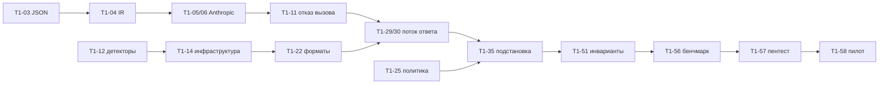

# Aegis — план работ

| | |
|---|---|
| Версия | 1.0-draft |
| Основание | [SPEC.md](SPEC.md) 1.0-draft |
| Статус | Черновик для обсуждения |

---

## 1. Принципы

1. **Каждая задача ссылается на требования спецификации.** Задача без ссылки на требование не берётся в работу. Требование без задачи — дефект плана (раздел 9 проверяет покрытие).
2. **Приёмка задачи = критерии требований**, на которые она ссылается. Тесты помечаются идентификатором требования (`// REQ: PSE-04`), и скрипт трассировки (`T0-10`) строит отчёт покрытия.
3. **Сначала риск, потом объём.** Самые рискованные места (верность протоколов, поведение клиентов при отказе, качество агента с псевдонимами) проверяются в первые недели Э1 (веха M1a).
4. **Гейт этапа — измеримые критерии из раздела `QA` спецификации.** Этап не закрывается по календарю.

### Определение готовности задачи

- Код и модульные тесты с пометками `REQ:`.
- Для детекторов — примеры в корпусе `QA-01`, полнота и точность не ниже целевых.
- Проверка «нет значений в логах» (`SEC-01`) проходит.
- Документация обновлена, если меняется поведение для администратора или пользователя.
- Ревью кода вторым инженером; для `aegis-core`, адаптеров и подстановки — ревью с фокусом на безопасность.

### Размеры и команда

Размеры: **S** — до 3 человеко-дней, **M** — до 2 человеко-недель, **L** — до 4 человеко-недель. Оценки грубые, ±30 %.

Допущение по команде: 3 инженера Rust, 1 инженер по качеству и данным, 0,5 DevOps/безопасности. Сроки ниже рассчитаны на этот состав.

---

## 2. Вехи

| Веха | Неделя (от старта) | Критерий выхода | Требования |
|---|---|---|---|
| **M0** · Стенд измерений | 8 | Корпус, бенчмарк, записи протоколов, нагрузочный стенд готовы; сняты базовые замеры агентов без Aegis | `QA-01`…`QA-03` |
| **M1a** · Прозрачный прокси | 10 | Все записанные сессии `QA-03` проходят через IR без изменений с побайтово равным результатом; подписи thinking принимаются реальным провайдером; проверено поведение Claude Code и Codex на отказ вызова инструмента (вопрос 5 из раздела 15 спецификации) | `PRO-01`…`PRO-06`, `IR-01`…`IR-04`, `INV-1`, `INV-2` |
| **M1b** · Маскирование | 16 | L0 и псевдонимизация работают; подстановка для `text` и `file_write`; сценарий `QA-06` проходит; первый прогон бенчмарка агентов через Aegis | `DET` (L0), `PSE`, `RST-01`…`RST-05`, `QA-06` |
| **M1c** · Безопасность | 20 | Места назначения shell и network, правило трёх условий, аудит, fail-closed; канареечный тест и набор эксфильтрации проходят | `RST-06`…`RST-10`, `POL-07`, `AUD`, `NFR-09`, `QA-07`, `QA-08` |
| **M1** · MVP | 24 | Все целевые метрики `QA-05` достигнуты; внешний пентест без открытых критичных находок; пилот запущен | Все требования Э1, `QA-09`, `SEC-12` |
| **M2** · Агенты и код | 24 + 18 | Критерии `QA-10` | Все требования Э2 |
| **M3** · Платформа | M2 + 26 | Критерии `QA-11` | Все требования Э3 |

```mermaid
gantt
  dateFormat  X
  axisFormat  нед %s
  section Э0
  Стенд измерений            :e0, 0, 8
  section Э1
  Каркас и протоколы         :a, 0, 10
  Детекция L0–L1             :c, 4, 16
  Псевдонимизация            :d, 8, 16
  Политика, бандл, CLI       :e, 8, 16
  Ответ и подстановка        :f, 10, 20
  Аудит, IAM, наблюдаемость  :h, 14, 20
  Надёжность и производит.   :i, 16, 22
  Приёмка, пентест           :k, 20, 24
  Пилот                      :p, 22, 28
```

---

## 3. Этап 0 — стенд измерений

| ID | Задача | Размер | Зависит от | Требования | Результат и приёмка |
|---|---|---|---|---|---|
| T0-01 | Репозиторий: Rust workspace (`aegis-core`, `aegis-gateway`, `aegis-cli`, `aegis-bench`), CI со сборкой, тестами, `clippy`, `cargo-deny`, `cargo-audit` | S | — | `SEC-09` (часть) | CI зелёный на пустом каркасе |
| T0-02 | Формат разметки корпуса (файл, смещения, тип) и оценщик: полнота и точность по типам, ложные срабатывания на 10 тыс. строк | M | T0-01 | `QA-01` | Оценщик выдаёт отчёт по любому детектору с интерфейсом из `T1-11` |
| T0-03 | Генератор синтетических репозиториев и конфигов со вставками: секреты всех типов `DET-04`, хосты, IP, строки подключения, ПДн, ФИО в разных падежах, корпоративные имена; задачи со «спрятанной» причиной бага | L | T0-02 | `QA-01`, `QA-02` | Не менее 5 тыс. размеченных вставок по всем типам каталога |
| T0-04 | Отрицательный корпус: не менее 10 млн строк открытого кода, lockfile'ы, хеши, UUID, фикстуры | S | T0-02 | `QA-01` | Корпус версионирован, лицензии проверены |
| T0-05 | Бенчмарк агентов: 50+ задач, запуск Claude Code и Codex в изолированных контейнерах, оценка успеха по тестам задачи, режимы «напрямую» и «через прокси» | L | T0-03 | `QA-02` | Повторяемость: разброс успешности между прогонами ≤ 3 п. п. |
| T0-06 | Запись и воспроизведение протоколов: записывающий прокси, кассеты, не менее 1000 запросов Anthropic и OpenAI (поток, thinking, tool calls, `cache_control`) на синтетике | M | T0-01 | `QA-03` | Кассеты воспроизводятся против mock-провайдера |
| T0-07 | Нагрузочный стенд: генератор агентных разговоров до 200 тыс. токенов, mock-провайдер с потоковыми ответами и настраиваемой задержкой | M | T0-06 | `NFR-01`…`NFR-04` (измерение) | Стенд выдаёт p50/p95 накладных расходов и пропускную способность |
| T0-08 | Набор эксфильтрации: 100+ сценариев prompt injection в README, комментариях, результатах WebFetch | M | T0-03 | `QA-08` | Сценарии запускаются автоматически в бенчмарке |
| T0-09 | Базовые замеры без Aegis: успешность агентов, доля попаданий в prompt cache | S | T0-05 | `QA-05` (база) | Отчёт с базовыми значениями |
| T0-10 | Скрипт трассировки: собирает пометки `REQ:` из тестов и строит отчёт «требование → тесты» по этапам | S | T0-01 | Принцип 2 | Отчёт в CI, требования Э1 без тестов подсвечиваются |

**Гейт M0:** все задачи Э0 выполнены, базовые замеры записаны.

---

## 4. Этап 1 — MVP

### 4.A Каркас

| ID | Задача | Размер | Зависит от | Требования | Результат и приёмка |
|---|---|---|---|---|---|
| T1-01 | `aegis-core` без ввода-вывода; тип `Sensitive<T>` со скрытым `Debug`/`Display`; запрет логирования типов запроса (lint в CI) | M | T0-01 | `SEC-01`, `INV-6` | Попытка залогировать `Sensitive` не компилируется или ловится lint'ом |
| T1-02 | Сервер `aegis-gateway`: TLS, mTLS по настройке, отдельный служебный порт, `/healthz`, `/readyz`, плавная остановка, ограничения размера и глубины | M | T0-01 | `SEC-05`, `SEC-06`, `OBS-04`, `NFR-06`, `NFR-07` | Остановка не обрывает активные потоки до 10 мин |

### 4.B Протоколы и IR

| ID | Задача | Размер | Зависит от | Требования | Результат и приёмка |
|---|---|---|---|---|---|
| T1-03 | Слой JSON с сохранением порядка ключей, форматирования чисел и неизвестных полей; правка строк на месте | M | T0-01 | `PRO-04`, `IR-04` | Чтение и запись без правок дают побайтово тот же JSON на всех кассетах `QA-03` |
| T1-04 | IR: блоки, роли, хеши, непрозрачные блоки, связь `tool_result` → `tool_use` | M | T1-03 | `IR-01`…`IR-03`, `INV-2` | Property-тест: IR → JSON без изменений = исходный JSON |
| T1-05 | Адаптер Anthropic: `/v1/messages` без потока, `count_tokens`, `models`, передача `anthropic-*`, сохранение `cache_control` | M | T1-04 | `PRO-01`, `PRO-05` | Кассеты Anthropic без потока проходят |
| T1-06 | Потоковый режим Anthropic: все типы событий, thinking и подписи без изменений | M | T1-05 | `PRO-06`, `RSP-03` | Кассеты с потоком проходят; живой тест: подпись thinking принимается провайдером после прохода через Aegis |
| T1-07 | Адаптер OpenAI Chat с потоком и `tool_calls` | M | T1-04 | `PRO-02`, `PRO-06` | Кассеты OpenAI Chat проходят |
| T1-08 | Адаптер OpenAI Responses без состояния с потоком; отказ для `store: true` и `previous_response_id` | M | T1-04 | `PRO-03`, `PRO-06` | Кассеты Responses проходят; stateful-запросы получают `API-03` |
| T1-09 | Вложения, эмбеддинги, серверные инструменты провайдера, неизвестные эндпоинты и поля | S | T1-05, T1-07, T1-08 | `PRO-07`…`PRO-10`, `POL-05` | Тесты на каждое действие по умолчанию и по политике |
| T1-10 | Клиент провайдера: учётные данные, таймауты, повторное соединение, передача ошибок | S | T1-02 | `RSP-09`, `IAM-02` | Ошибки провайдера доходят до клиента без изменений; ключ провайдера не виден клиенту |
| T1-11 | **Проверка поведения клиентов при отказе вызова инструмента** (прототип на mock-провайдере): удаление вызова с текстом против подмены команды | S | T1-06, T1-07 | `RSP-07` (риск R2) | Решение записано в ADR до начала T1-34 |

### 4.C Детекция

| ID | Задача | Размер | Зависит от | Требования | Результат и приёмка |
|---|---|---|---|---|---|
| T1-12 | Каркас детекторов: интерфейс, версии, оркестрация уровней, бюджеты времени, кэш по хешу блока без значений | M | T1-04 | `DET-01`…`DET-03`, `DET-09` | Повторный блок не сканируется (метрика попаданий); прерывание по бюджету |
| T1-13 | L0: секреты известных форматов, PEM и OpenSSH | M | T1-12 | `DET-04` (SECRET) | Полнота ≥ 99 % на корпусе |
| T1-14 | L0: структурный разбор URL и строк подключения (JDBC, PostgreSQL, MySQL, MongoDB, Redis, AMQP, ODBC), хосты и зоны, IPv4/IPv6/CIDR | M | T1-12 | `DET-04` (INFRA, `SECRET kind=password` в строках) | Полнота по инфраструктуре ≥ 95 % |
| T1-15 | L0: ПДн известных форматов с контрольными суммами | S | T1-12 | `DET-04` (PII кроме PERSON) | Полнота ≥ 98 % |
| T1-16 | Словари и Aho–Corasick; сборщик словаря сотрудников из выгрузки AD/LDAP с падежными формами (по словарю OpenCorpora) и транслитерацией ICAO | L | T1-12 | `DET-04` (PERSON, CORP), `DET-06` | Полнота по сотрудникам из словаря ≥ 95 %, в бандле только формы имён |
| T1-17 | Связывание сущностей «имя ↔ email» | S | T1-16 | `DET-07` | Не зависит от порядка: тест с перестановками |
| T1-18 | L1: контекст tree-sitter (Python, Go, Java, JS/TS, C#, Kotlin) и конфигов (YAML, JSON, `.env`, `.properties`, HCL, Dockerfile); пароли в присваиваниях, энтропия, подавление ложных срабатываний | L | T1-12 | `DET-04` (`password`, `generic`), `DET-05` | Ложные срабатывания < 1 на 10 тыс. строк |
| T1-19 | Собственные детекторы компании из бандла с обязательными примерами | S | T1-12, T1-27 | `DET-08` | Бандл без примеров не собирается |
| T1-20 | Настройка детекторов по корпусу до целевых метрик | M | T1-13…T1-18 | `QA-05` (детекция) | Отчёт оценщика: все целевые значения детекции достигнуты |

### 4.D Псевдонимизация

| ID | Задача | Размер | Зависит от | Требования | Результат и приёмка |
|---|---|---|---|---|---|
| T1-21 | Загрузка ключей (Vault, файл, плагин KMS), соль разговора, вычисление `id`, коллизии; идентификатор тенанта во всех вычислениях | S | T1-01 | `PSE-01`…`PSE-04`, `CFG-05`, `SEC-03`, `SEC-08`, `PLT-01` (часть Э1) | Тест детерминизма; тест коллизий на искусственно укороченном `id` |
| T1-22 | Форматы: маркеры, Crypto-PAn для IPv4/IPv6/CIDR в класс E и 3fff::/20, хосты с ролью, окружением и зоной, URL, строки подключения, связанные значения, атрибуты секретов | L | T1-21, T1-14 | `PSE-05`…`PSE-09` | Свойства: подсети сохраняются; хосты одной зоны получают один `z-…`; все формы ФИО дают один маркер; маркер ≤ 96 символов |
| T1-23 | Экранирование псевдонимоподобных строк входа (`LIT`) и вставка уведомления для модели во всех трёх протоколах | S | T1-22, T1-05, T1-07, T1-08 | `PSE-10`, `PSE-11`, `API-05` | Подложенный маркер не восстанавливается в реальное значение; уведомление не ломает кэш (кассеты) |
| T1-24 | Действия на входе: `allow`, `mask`, `drop_block`, `block_request` и форматы ошибок по протоколам | S | T1-22 | `PSE-12`, `API-03` | Ошибка показывается в Claude Code и Codex с текстом и правилом |

### 4.E Политика, бандл, CLI

| ID | Задача | Размер | Зависит от | Требования | Результат и приёмка |
|---|---|---|---|---|---|
| T1-25 | Схема политики (JSON Schema), вычислитель правил, идентификаторы правил в решениях, политика по умолчанию | M | T1-04 | `POL-01`…`POL-04`, `POL-06`, `API-07` | Пример `API-07` валиден; таблица `RST-03` воспроизводится политикой по умолчанию |
| T1-26 | Правило трёх условий: флаги `P`, `U`, режимы `enforce` и `monitor`, разрешённые адресаты | S | T1-25, T1-33 | `POL-07`, `POL-08` | Сценарии эксфильтрации блокируются в `enforce`, только пишутся в аудит в `monitor` |
| T1-27 | Бандл: формат, подпись Ed25519, загрузка из файла и по HTTPS, применение без перезапуска, срок действия, отказ при неверной подписи | M | T1-25 | `CFG-01`, `CFG-02`, `CFG-04` | Новая версия применяется ≤ 30 с; истёкший бандл → `/readyz` не готов и fail-closed |
| T1-28 | `aegis-cli`: `bundle build` (схема, компиляция, тесты детекторов и политики, подпись), `policy test`, выпуск и отзыв виртуальных ключей | M | T1-27 | `CFG-03`, `POL-09`, `IAM-03` | Сборка падает при любой ошибке; отзыв ключа действует ≤ 60 с |

### 4.F Ответ и подстановка

| ID | Задача | Размер | Зависит от | Требования | Результат и приёмка |
|---|---|---|---|---|---|
| T1-29 | Окно удержания текста в потоке для всех протоколов | M | T1-06, T1-07, T1-08, T1-22 | `RSP-01`, `NFR-03` | Псевдоним, разрезанный на любые чанки, восстанавливается; удержание ≤ 128 символов |
| T1-30 | Полная буферизация аргументов вызовов инструментов и повторная выдача одной дельтой | M | T1-29 | `RSP-02` | Кассеты с tool calls проходят |
| T1-31 | Нормализация искажённых псевдонимов, учёт неразрешённых | S | T1-22 | `RSP-04`, `RSP-05` | Набор искажений из спецификации распознаётся; производные значения не восстанавливаются |
| T1-32 | Классификатор мест назначения: встроенная таблица Claude Code и Codex, MCP, `unknown` | S | T1-04 | `RST-04` | Каждый инструмент таблицы покрыт тестом |
| T1-33 | Shell-лексер и классификатор `shell_local`/`shell_network`, извлечение адресатов | M | T1-32 | `RST-07`, `RST-10` | Набор из 300+ команд размечен и классифицируется верно; фаззинг без паник |
| T1-34 | Провенанс сущностей и `origin_only` | S | T1-04, T1-22 | `RST-08` | Секрет восстанавливается только в правку того же файла |
| T1-35 | Движок подстановки: действия, отказ вызова, смена причины остановки по протоколам, текст отказа | M | T1-11, T1-30…T1-34, T1-25 | `RST-01`…`RST-03`, `RST-05`, `RST-06`, `RST-09`, `RSP-07`, `API-04`, `INV-3`…`INV-5` | Маркер никогда не уходит в `file_write`; сценарий `QA-06` проходит |
| T1-36 | Проверка ответа на захардкоженные секреты | S | T1-13, T1-35 | `RSP-06` | Действия `warn` и `deny` работают |
| T1-37 | Ответы без потока через тот же конвейер | S | T1-35 | `RSP-08` | Кассеты без потока проходят |

### 4.G Доступ и маршруты

| ID | Задача | Размер | Зависит от | Требования | Результат и приёмка |
|---|---|---|---|---|---|
| T1-38 | Виртуальные ключи, принципал и группы, определение клиента | S | T1-27 | `IAM-01`, `IAM-03`, `IAM-05` | Ключи в бандле только хешами |
| T1-39 | Статические маршруты, алиасы моделей, `/v1/models` по маршрутам принципала | S | T1-25, T1-10 | `RTE-01`, `RTE-02` | Маршрут на локальную модель работает с ослабленной политикой `R-010` |

### 4.H Аудит и наблюдаемость

| ID | Задача | Размер | Зависит от | Требования | Результат и приёмка |
|---|---|---|---|---|---|
| T1-40 | События аудита, `audit_hash` на `K_audit`, хеш разговора, вывод JSONL и OTLP, очередь, режим `audit.required`, заголовок `X-Aegis-Summary` | M | T1-35, T1-21 | `AUD-01`…`AUD-04`, `AUD-06`, `API-06` | Событие совпадает со схемой `API-06`; переполнение очереди не блокирует трафик (или блокирует в режиме `required`) |
| T1-41 | `aegis-cli report` по периоду и по разговору | S | T1-40 | `AUD-05` | Отчёт по задаче агента из бенчмарка |
| T1-42 | Метрики Prometheus и трассировки OpenTelemetry без значений | S | T1-12, T1-35 | `OBS-01`…`OBS-03` | Канареечный тест покрывает метрики и трассировки |

### 4.I Надёжность, безопасность, производительность

| ID | Задача | Размер | Зависит от | Требования | Результат и приёмка |
|---|---|---|---|---|---|
| T1-43 | Пути fail-closed: бандл, ключи, бюджет детектора, падение детектора; fail-open только для `INFRA`/`CORP` по политике | S | T1-12, T1-27 | `NFR-09`, `CFG-04` | Тест на каждый путь отказа |
| T1-44 | Защита процесса: дампы памяти, обработчик паники, `zeroize`, только линейные регулярные выражения, лимиты | S | T1-02 | `SEC-02`, `SEC-04`, `SEC-11` | Проверка в CI и на собранном образе |
| T1-45 | Фаззинг: адаптеры, SSE, URL, строки подключения, shell-лексер, YAML бандла | M | T1-05…T1-08, T1-14, T1-33, T1-27 | `SEC-10` | Фаззеры в ночном CI, 24 ч без падений перед M1 |
| T1-46 | Цепочка поставки: SBOM, подпись образов | S | T1-49 | `SEC-09` | Образ подписан, SBOM опубликован с релизом |
| T1-47 | Оптимизация до целевых показателей; проверка масштабирования до 16 узлов | M | T0-07, T1-35 | `NFR-01`…`NFR-05`, `NFR-11` | Отчёт нагрузочного стенда с выполненными целями |

### 4.J Поставка и документация

| ID | Задача | Размер | Зависит от | Требования | Результат и приёмка |
|---|---|---|---|---|---|
| T1-48 | Документация: руководство администратора и автора политики, модель угроз, процедура ротации ключей, шаблон описания обработки ПДн, рекомендации по настройкам провайдеров, проверка формулировок | M | T1-35, T1-40 | `CMP-01`…`CMP-03`, `CMP-05`, `SEC-03`, `SEC-07` | Юрист и ИБ пилотного заказчика подтвердили шаблон |
| T1-49 | Образы linux/amd64 и linux/arm64, Helm-чарт, systemd-юнит, офлайн-комплект для air-gapped | M | T1-02 | `NFR-08`, `NFR-10` | Установка в изолированной сети без интернета |
| T1-50 | Эталонные правила egress и список доменов AI-сервисов; инструкции подключения Claude Code и Codex | S | T1-49 | `EGR-01`, `EGR-02` | Проверено на стенде: прямой доступ блокируется, клиенты работают через gateway |

### 4.K Приёмка и пилот

| ID | Задача | Размер | Зависит от | Требования | Результат и приёмка |
|---|---|---|---|---|---|
| T1-51 | Property-тесты инвариантов, воспроизведение кассет, живая проверка подписей thinking | M | T1-35, T1-37 | `QA-04`, `INV-1`…`INV-6` | 0 нарушений |
| T1-52 | Сквозной тест сценария из концепции | S | T1-35, T1-40 | `QA-06` | Тест в CI |
| T1-53 | Канареечный тест | S | T1-40, T1-42 | `QA-07`, `SEC-01` | Ни одного значения из корпуса вне трафика к провайдеру с действием `allow` |
| T1-54 | Прогон набора эксфильтрации | S | T1-26, T1-35, T0-08 | `QA-08` | 0 успешных эксфильтраций |
| T1-55 | Гейты CI для `QA-04`…`QA-08` | S | T1-51…T1-54 | `QA-09` | Регрессия блокирует релиз |
| T1-56 | Прогон бенчмарка агентов через Aegis, замер кэша | S | T1-35, T0-09 | `QA-05` | Падение успешности ≤ 3 п. п., кэш ≥ 98 % от базы |
| T1-57 | Внешний пентест и исправление находок | M | T1-55 | `SEC-12` | Нет открытых критичных и высоких находок |
| T1-58 | Пилот у заказчика: установка, подключение 10–30 разработчиков, сбор обратной связи, подтверждение допущений ДОП-1…ДОП-5 | L | T1-57, T1-48…T1-50 | Раздел 15 спецификации | Отчёт пилота: ложные срабатывания, жалобы, подтверждённые допущения |

---

## 5. Этап 2 — агенты и код

| ID | Задача | Размер | Зависит от | Требования |
|---|---|---|---|---|
| T2-01 | `aegis-guard`: хуки перед вызовом инструмента, правила путей, команд, адресатов, время решения ≤ 20 мс | M | M1 | `AGG-01`, `AGG-02`, `AGG-07` |
| T2-02 | Подтверждение пользователя вместо `deny` для `shell_local` с ПДн | S | T2-01 | `AGG-03`, `RST-09` |
| T2-03 | Генерация настроек песочницы клиента | S | T2-01 | `AGG-04` |
| T2-04 | Передача `X-Aegis-Conversation` и `X-Aegis-Client` | S | T2-01 | `AGG-05` |
| T2-05 | Распространение через управляемые настройки клиента | S | T2-01 | `AGG-06` |
| T2-06 | `aegis-mcp`: прокси stdio и Streamable HTTP | M | M1 | `MCP-01` |
| T2-07 | Белый список инструментов, ограничения аргументов, SQL только на чтение | M | T2-06 | `MCP-02`, `MCP-03` |
| T2-08 | Минимизация результатов; метки доверия и выхода наружу в политике gateway | S | T2-06 | `MCP-04`, `MCP-05` |
| T2-09 | `aegis-index`: нормализация tree-sitter, winnowing, хранилище хешей | L | M1 | `DET-20` |
| T2-10 | Инкрементальное обновление индекса по событиям Git | M | T2-09 | `DET-21` |
| T2-11 | Уровень L2 в gateway; подбор порога по корпусу | M | T2-09 | `DET-20`, раздел 15 спецификации (вопрос 4) |
| T2-12 | Динамическая маршрутизация, закрепление за разговором, проверка совместимости | M | T2-11 | `RTE-03`…`RTE-05` |
| T2-13 | OIDC | S | M1 | `IAM-04` |
| T2-14 | Адаптеры Bedrock, Vertex, российских моделей | L | M1 | `PRO-12` |
| T2-15 | Расширение корпуса и бенчмарка: закрытый код, MCP, Agent Guard | M | M1 | `QA-10` |

**Гейт M2:** критерии `QA-10`; все `QA-04`…`QA-08` остаются зелёными.

---

## 6. Этап 3 — платформа

| ID | Задача | Размер | Требования |
|---|---|---|---|
| T3-01 | NER для русского и английского текста (L3), локальная модель | L | `DET-30` |
| T3-02 | Семантическая классификация (L4) | L | `DET-31` |
| T3-03 | Мультимодальность: OCR, извлечение текста из PDF | L | `DET-32`, `PRO-07` |
| T3-04 | Stateful-протоколы с журналом маппинга | L | `PRO-11` |
| T3-05 | Мультитенантность | L | `PLT-01` |
| T3-06 | Сервис control plane и консоль | L | `PLT-02` |
| T3-07 | Чат-портал с предпросмотром замен | L | `PLT-03` |
| T3-08 | Break-glass | M | `PLT-04`, `SEC-07` |
| T3-09 | Обнаружение shadow AI | M | `EGR-03` |
| T3-10 | Криптопровайдер ГОСТ | M | `CMP-04` |
| T3-11 | Программа поиска обходов детекции | S | `SEC-12` |

**Гейт M3:** критерии `QA-11`.

---

## 7. Критический путь Э1

Верность протоколов и поток ответа — самая длинная цепочка, поэтому каркас и адаптеры стартуют одновременно со стендом Э0.

---

## 8. Риски плана

| ID | Риск | Признак | Ответ |
|---|---|---|---|
| R1 | Провайдеры меняют API и события потока | Падают ночные контрактные тесты | Записывающий прокси `T0-06`; ночные живые тесты; неизвестные события проходят без изменений (`PRO-06`) |
| R2 | Клиенты плохо переносят удаление вызова инструмента | Агент зависает или повторяет вызов | Проверка в `T1-11` до начала `T1-35`; запасной вариант — подмена команды на безопасную заглушку |
| R3 | Цели детекции паролей и `generic` недостижимы без роста ложных срабатываний | Отчёт `T1-20` ниже цели | Опора на структурный разбор; пересмотр целей для `generic` через изменение спецификации |
| R4 | Качество морфологии русских ФИО | Полнота по словарю < 95 % | Генерация форм офлайн по словарю OpenCorpora; ручные исключения в бандле |
| R5 | tree-sitter не укладывается в бюджет на больших блоках | p95 выше цели | Запуск L1 только по сигналу L0; ограничение размера блока для L1 |
| R6 | Псевдонимы (класс E, маркеры) снижают качество агента | Падение успешности > 3 п. п. на M1b | Ранний прогон на M1b; правка текста уведомления; переключение форматов по типам |
| R7 | Уведомление или нормализация ломают prompt cache | Доля попаданий < 98 % | Замер на M1a по кассетам |
| R8 | Нет пилотного заказчика или юридического согласования к неделе 22 | — | Поиск пилота параллельно с Э1; шаблон `CMP-02` готовится заранее |
| R9 | Найм инженеров Rust | Вакансии открыты дольше 6 недель | Начать с меньшей командой: Э0 и каркас не требуют полного состава |

---

## 9. Покрытие требований задачами

Каждое требование спецификации покрыто хотя бы одной задачей.

| Требования | Задачи |
|---|---|
| `PRO-01`, `PRO-05` | T1-05 |
| `PRO-02` | T1-07 |
| `PRO-03` | T1-08 |
| `PRO-04` | T1-03 |
| `PRO-06` | T1-06, T1-07, T1-08 |
| `PRO-07`…`PRO-10` | T1-09 (`PRO-07` в Э3 — T3-03) |
| `PRO-11` | T3-04 |
| `PRO-12` | T2-14 |
| `IR-01`…`IR-03` | T1-04 |
| `IR-04` | T1-03 |
| `DET-01`…`DET-03`, `DET-09` | T1-12 |
| `DET-04` | T1-13, T1-14, T1-15, T1-16, T1-18; `LIT` — T1-23 |
| `DET-05` | T1-18 |
| `DET-06` | T1-16 |
| `DET-07` | T1-17 |
| `DET-08` | T1-19 |
| `DET-20` | T2-09, T2-11 |
| `DET-21` | T2-10 |
| `DET-30`…`DET-32` | T3-01…T3-03 |
| `PSE-01`…`PSE-04` | T1-21 |
| `PSE-05`…`PSE-09` | T1-22 |
| `PSE-10`, `PSE-11` | T1-23 |
| `PSE-12` | T1-24 |
| `POL-01`…`POL-04`, `POL-06` | T1-25 |
| `POL-05` | T1-09 |
| `POL-07`, `POL-08` | T1-26 |
| `POL-09` | T1-28 |
| `RSP-01` | T1-29 |
| `RSP-02` | T1-30 |
| `RSP-03` | T1-06 |
| `RSP-04`, `RSP-05` | T1-31 |
| `RSP-06` | T1-36 |
| `RSP-07` | T1-11, T1-35 |
| `RSP-08` | T1-37 |
| `RSP-09` | T1-10 |
| `RST-01`…`RST-03`, `RST-05`, `RST-06`, `RST-09` | T1-35 (`RST-09` в Э2 — T2-02) |
| `RST-04` | T1-32 |
| `RST-07`, `RST-10` | T1-33 |
| `RST-08` | T1-34 |
| `RTE-01`, `RTE-02` | T1-39 |
| `RTE-03`…`RTE-05` | T2-12 |
| `IAM-01`, `IAM-03`, `IAM-05` | T1-38, T1-28 |
| `IAM-02` | T1-10 |
| `IAM-04` | T2-13 |
| `AUD-01`…`AUD-04`, `AUD-06` | T1-40 |
| `AUD-05` | T1-41 |
| `CFG-01`, `CFG-02`, `CFG-04` | T1-27 |
| `CFG-03` | T1-28 |
| `CFG-05` | T1-21 |
| `OBS-01`…`OBS-03` | T1-42 |
| `OBS-04` | T1-02 |
| `AGG-01`…`AGG-07` | T2-01…T2-05 |
| `MCP-01`…`MCP-05` | T2-06…T2-08 |
| `EGR-01`, `EGR-02` | T1-50 |
| `EGR-03` | T3-09 |
| `PLT-01` | T1-21 (часть Э1), T3-05 |
| `PLT-02`…`PLT-04` | T3-06…T3-08 |
| `NFR-01`…`NFR-05`, `NFR-11` | T1-47 (измерение — T0-07) |
| `NFR-06`, `NFR-07` | T1-02 |
| `NFR-08`, `NFR-10` | T1-49 |
| `NFR-09` | T1-43 |
| `SEC-01` | T1-01, T1-53 |
| `SEC-02`, `SEC-04`, `SEC-11` | T1-44 |
| `SEC-03` | T1-21, T1-48 |
| `SEC-05`, `SEC-06` | T1-02 |
| `SEC-07` | T1-48, T3-08 |
| `SEC-08` | T1-21 |
| `SEC-09` | T0-01, T1-46 |
| `SEC-10` | T1-45 |
| `SEC-12` | T1-57, T3-11 |
| `CMP-01`…`CMP-03`, `CMP-05` | T1-48 |
| `CMP-04` | T3-10 |
| `QA-01` | T0-02, T0-03, T0-04 |
| `QA-02` | T0-03, T0-05 |
| `QA-03` | T0-06 |
| `QA-04` | T1-51 |
| `QA-05` | T0-09, T1-20, T1-47, T1-56 |
| `QA-06` | T1-52 |
| `QA-07` | T1-53 |
| `QA-08` | T0-08, T1-54 |
| `QA-09` | T1-55 |
| `QA-10` | T2-15, гейт M2 |
| `QA-11` | Гейт M3 |
| `API-01` | T1-05, T1-07, T1-08, T1-09, T1-02 |
| `API-02` | T1-38, T1-40 |
| `API-03` | T1-24 |
| `API-04` | T1-35 |
| `API-05` | T1-23 |
| `API-06` | T1-40 |
| `API-07` | T1-25 |
| `INV-1`…`INV-6` | T1-51 (реализация — T1-03, T1-04, T1-21, T1-35, T1-01) |
